<div align="center">

# 🛡️ BrandProof (BrandLedger AI)
### *Intelligent Brand Governance & Proof Engine*

**"Every finding comes with proof."**

[](https://fastapi.tiangolo.com)
[](https://react.dev)
[](https://www.typescriptlang.org)
[](https://tailwindcss.com)
[](https://www.python.org)
[](#-automated-testing--benchmarks)
[](#-golden-benchmark-results)

<p align="center">
  <a href="#-the-problem">The Problem</a> •
  <a href="#-core-breakthroughs">Core Breakthroughs</a> •
  <a href="#-workflow-stages--19-must-features">Workflow Stages</a> •
  <a href="#-system-architecture">Architecture</a> •
  <a href="#-quick-start-guide">Quick Start</a> •
  <a href="#-demo-personas--role-matrix">Demo Personas</a> •
  <a href="#-api-endpoints">API Reference</a> •
  <a href="#-security--privacy-gate">Privacy</a>
</p>

---

</div>

## 📌 Executive Summary

**BrandProof** is an enterprise-grade brand governance platform that validates public-facing content against an organization's verified **Source of Truth** before publication. 

Unlike generic LLM checkers that hallucinate rules or offer vague style critiques, BrandProof:
- 📖 **Proves every finding** with a verifiable citation linking to the exact rule code, source guideline document, page number, and quote.
- 🛂 **Verifies claims with Claim Passport**, blocking expired statistics and unsubstantiated ranking claims against an owner-attributed Facts Vault.
- 🔒 **Protects creator intent via Intent Lock**, ensuring suggested edits preserve core purpose, audience, and key messaging.
- 🛡️ **Prevents rubber-stamping** through strict role segregation: authors can never approve their own drafts.
- 📄 **Issues tamper-proof PDF Approval Certificates** with cryptographic SHA-256 hashes and complete audit trails.

---

## ⚡ The Problem vs. The BrandProof Solution

| The Old Way (Fragmented & Vulnerable) | The BrandProof Way (Intelligent & Governed) |
|---|---|
| **Outdated Claims:** Outdated statistics circulate indefinitely in marketing decks. | **Approved Facts Vault & Claim Passport:** Every promotional metric is backed by an owner, expiry date, and verified benchmark. |
| **Vague Guidelines:** Long 80-page brand PDFs with abstract rules like *"friendly yet authoritative"* are impossible to enforce. | **Rulebook Compiler:** Automatically ingests guideline PDFs into deterministic AST rules with explicit good/bad examples. |
| **Hallucinated AI Checks:** LLMs review against their own internal opinions, yielding false positives. | **Proof-Backed Review Engine:** AI is constrained to a structured JSON schema citing the verified guideline or fact ID. |
| **Expensive Latency:** Every comma triggers an expensive 10-second external AI API call. | **Hybrid Review Pipeline:** Deterministic checks (banned terms, WCAG contrast, alt-text) run locally in **<15ms** for $0. |
| **Arbitrary Rejections:** Creators receive flat "denied" statuses with no rationale. | **Actionable Proof Cards:** Highlights issue, names rule/fact, provides context, and gives a 1-click inline replacement. |
| **Privacy Leaks:** Proprietary drafts are pasted into public AI models without masking. | **Privacy Gate:** Client-side regex masks PII (emails, phones, credentials) before any external AI call. |

---

## 💡 Five Core Breakthroughs

```
┌────────────────────────────────────────────────────────────────────────┐
│                        BRANDPROOF CORE PILLARS                         │
└────────────────────────────────────────────────────────────────────────┘
     │                    │                    │                   │
     ▼                    ▼                    ▼                   ▼
1. RULEBOOK         2. HYBRID REVIEW     3. CLAIM PASSPORT   4. INTENT LOCK
   COMPILER            PIPELINE             FACT VAULT          PRESERVATION
Ingests brand PDFs  Fixed checks run in  Matches promotional Suggestion engine
into testable AST   <15ms ($0 cost). AI  claims to verified  honors brief goals
rules with page     called strictly for  facts with owners   and verifies zero
and line citations. nuanced judgement.   & expiry dates.     meaning loss.
                                  │
                                  ▼
                        5. RULE HEALTH & LEARN
                        Surfaces vague rules with >30%
                        override rates and suggests rewrites.
```

### 1. Rulebook Compiler
Turns unread brand guidelines into structured, version-controlled rules. Each compiled rule includes category, severity, source document, page number, exact quote, and verified good vs. bad examples.

### 2. Hybrid Review Engine
Separates mechanical validation from creative judgement.
- **Deterministic Pre-Check:** Executes regex dictionaries, banned phrases, whole-word boundaries, WCAG 2.1 AA color contrast ratios, readability grades, and link safety in under **15 milliseconds**.
- **Contextual AI Review:** Invoked only when needed for tone alignment and semantic claim verification.
- **Zero-Cost Rules-Only Mode:** One-click toggle that bypasses AI entirely for instantaneous, air-gapped deterministic compliance checks.

### 3. Claim Passport
Every factual claim must hold a valid passport. Claims are parsed and compared against the **Approved Facts Vault** using token overlap and MiniLM embeddings:
- ✅ **Supported:** Claim matches a verified active fact within valid dates.
- ⚠️ **Outdated:** Claim references a fact whose validity period has expired (e.g., `valid_until: 2026-06-30`).
- ❌ **Unsupported:** Unsubstantiated superlative or ranking claims (e.g., *“#1 platform in the world”*) with no benchmark on file.

### 4. Intent Lock
Before drafting, creators declare:
1. **Purpose** (e.g., *Enterprise product launch announcement*)
2. **Audience** (e.g., *DevOps Engineers & Infrastructure Directors*)
3. **Key Message** (e.g., *Unrivaled platform stability and 99.99% SLA*)

When BrandProof suggests fixes, it evaluates the candidate text against the Intent Lock to verify that core meaning is never compromised.

### 5. Rule Health & Continuous Learning Loop
Tracks creator behavior over time. Rules with high rejection or dispute rates (>30%) are flagged as ambiguous, prompting Brand Managers with actionable recommendations to clarify rule definitions.

---

## 🔄 Workflow Stages & 19 Must Features

BrandProof completely covers the 19 Must Features across the 5 lifecycle stages:

```mermaid
flowchart LR
    subgraph S1["Stage 1: Source of Truth"]
        R[Rulebook Compiler]
        F[Facts Vault]
        T[Terminology Dict]
        A[Asset Reference]
    end

    subgraph S2["Stage 2: Review Engine"]
        DET["Deterministic Pre-Check (<15ms)"]
        PRIV["PII Privacy Masking Gate"]
        CP["Claim Passport Matching"]
        IL["Intent Lock Validation"]
    end

    subgraph S3["Stage 3: Explain & Fix"]
        FP["FindingProof Citations"]
        ACT["1-Click Inline Fixes"]
        DIS["Dismiss with Mandatory Reason"]
    end

    subgraph S4["Stage 4: Collaborate"]
        DIFF["Side-by-Side Version Diff"]
        ROLE["Role Separation Guard"]
        SIGN["Brand Manager Sign-Off"]
        PDF["Tamper-Proof PDF Export"]
    end

    subgraph S5["Stage 5: Learn Loop"]
        DASH["Governance KPI Dashboard"]
        RH["Rule Health (>30% Alerts)"]
        REC["Recurring Mistake Clusters"]
    end

    S1 --> S2 --> S3 --> S4 --> S5
```



### Feature Implementation Matrix

| Stage | Feature | Implementation Details | Status |
|---|---|---|:---:|
| **1. Source of Truth** | **1. Rulebook Compiler** | Ingests PDF/Docx guidelines into AST candidate rules with page & quote citations (`/rules/compile`). | ✅ **100%** |
| | **2. Approved Facts Vault** | Fact repository with owner attribution, source documentation, and expiration dates (`/facts`). | ✅ **100%** |
| | **3. Banned Terminology** | Regex & whole-word matching dictionary with preferred replacement suggestions (`/terms`). | ✅ **100%** |
| | **4. Digital Asset Reference**| Approved logo specs, hex color palettes, typography, and minimum clear-space guidelines (`/assets`). | ✅ **100%** |
| **2. Review Engine** | **5. Deterministic Pre-Check** | Runs banned words, terms, link formatting, and WCAG contrast in <15ms. | ✅ **100%** |
| | **6. Semantic Tone Checker** | Evaluates voice tone, emotional resonance, and banned superlatives against brand guidelines. | ✅ **100%** |
| | **7. Claim Passport** | Token overlap and semantic embeddings verify metrics against the Facts Vault. | ✅ **100%** |
| | **8. Rules-Only Mode Toggle** | Bypasses all AI execution for instant, $0 cost deterministic evaluation. | ✅ **100%** |
| | **9. Intent Lock** | Compares suggestions against declared purpose, audience, and key messaging. | ✅ **100%** |
| **3. Explain & Fix** | **10. FindingProof Citations** | Attaches rule code, fact code, source doc, page number, and quote to every finding. | ✅ **100%** |
| | **11. Actionable Fix Suggestions**| Provides one-click inline replacements with visual before/after preview. | ✅ **100%** |
| | **12. Inline Workspace** | Real-time interactive editor with live finding cards, severity badges, and diff highlights. | ✅ **100%** |
| | **13. Dismiss with Reason** | Requires mandatory audit justification for dismissing critical or legal findings. | ✅ **100%** |
| **4. Collaborate** | **14. Role-Based Governance** | Enforces creator, reviewer, brand manager, and admin permissions via JWT. | ✅ **100%** |
| | **15. Reviewer Side-by-Side** | Diff comparison between original draft and revised version. | ✅ **100%** |
| | **16. Final Sign-off Guard** | Brand Manager approval with **anti-self-approval enforcement** (`CONTENT_SELF_APPROVAL`). | ✅ **100%** |
| | **17. Certified PDF Export** | Generates tamper-proof PDF approval certificates with SHA-256 verification hash. | ✅ **100%** |
| **5. Learn Loop** | **18. Governance Dashboard** | Real-time compliance health score, total findings, approval rates, and active vault counters. | ✅ **100%** |
| | **19. Continuous Rule Health** | Tracks accept/dismiss ratios, flags rules with >30% dispute rates, clusters recurring mistakes. | ✅ **100%** |

---

## 🏗️ System Architecture

```
BrandProof Full Stack Architecture
├── frontend/ (Vite + React 19 + TypeScript + TailwindCSS)
│   ├── src/
│   │   ├── api/             # Typed API Network Client (Auth, Knowledge, Content, Insights)
│   │   ├── components/      # UI Design System
│   │   │   ├── common/      # OriginBadge, ProofCitationBadge, Modal, Toast
│   │   │   ├── content/     # FindingCard, InlineReviewEditor, DiffViewer, ProofDrawer
│   │   │   └── layout/      # Navbar, Sidebar, RoleSwitcher, DemoBar
│   │   ├── context/         # AuthContext (Role switching & JWT token management)
│   │   └── pages/           # Pages (Dashboard, ContentStudio, ReviewWorkspace, Rules, Facts)
│   └── vite.config.ts       # Reverse proxy to port 8080
│
└── backend/ (FastAPI + Pydantic v2 + Python 3.10+)
    ├── app/
    │   ├── api/             # REST Endpoints
    │   │   ├── auth.py      # Demo login, JWT issuance, role management
    │   │   ├── knowledge.py # Rules, Rulebook Compiler, Facts Vault, Terms, Assets
    │   │   ├── content.py   # Draft lifecycle, check trigger, resolution, approve, PDF export
    │   │   └── insights.py  # Governance KPIs, Rule Health, Recurring Mistakes
    │   ├── engine/          # Governance Engine
    │   │   ├── checks.py    # Deterministic checks (Regex, Terms, Contrast, Alt-text)
    │   │   ├── ai.py        # Privacy Masking, Claim Passport embeddings, Tone analysis
    │   │   └── orchestrator.py # Pipeline coordinator & FindingProof builder
    │   ├── schemas.py       # Pydantic v2 models & API envelope
    │   └── store.py         # Thread-safe in-memory store pre-seeded with ApexCloud dataset
    └── tests/               # 17 Automated Tests (Golden benchmark, full stack sync, unit)
```

---

## 🧪 Automated Testing & Benchmarks

BrandProof comes with a 100% passing test suite across all levels of the pyramid:

```bash
backend/.venv/Scripts/pytest -v
```

```text
============================= test session starts =============================
platform win32 -- Python 3.14.4, pytest-9.1.1
collected 17 items

tests/golden/test_golden_runner.py .                                     [  5%]
tests/integration/test_auth_api.py ..                                    [ 17%]
tests/integration/test_content_workflow.py .                             [ 23%]
tests/integration/test_full_stack_sync.py .                              [ 29%]
tests/unit/test_claim_matching_poc.py .                                  [ 35%]
tests/unit/test_fixed_checks.py ........                                 [ 82%]
tests/unit/test_masking.py ...                                           [100%]

============================= 17 passed in 1.68s ==============================
```

### 🏆 Golden Benchmark Results
Tested against real-world adversarial enterprise marketing copy containing banned terminology, expired claims, unsubstantiated market rankings, and intent drifts:

- **Detection Rate:** **100%** (15 / 15 adversarial test cases caught)
- **Precision:** **100%** (0 false positives on compliant brand copy)
- **Explainability Score:** **100%** (every flagged issue has an exact citation to a rule or fact)
- **Deterministic Latency:** **<15 ms** average execution time

---

## 🚀 Quick Start Guide

You can run BrandProof locally in 2 terminals **without Docker**.

### Prerequisites
- **Python:** 3.10 or higher
- **Node.js:** v18 or higher (v20+ recommended)
- **npm:** v9 or higher

---

### Step 1: Start the Backend (Terminal 1)

```bash
# 1. Navigate to the backend directory
cd backend

# 2. Activate virtual environment
# Windows (PowerShell):
.venv\Scripts\Activate.ps1
# Windows (CMD):
.venv\Scripts\activate.bat
# macOS / Linux:
source .venv/bin/activate

# 3. (Optional) Install dependencies if needed
pip install -r requirements.txt

# 4. Start the FastAPI server on port 8080
uvicorn app.main:app --reload --port 8080
```

- 🟢 **Backend Live:** [http://localhost:8080](http://localhost:8080)
- 📖 **Interactive Swagger Docs:** [http://localhost:8080/docs](http://localhost:8080/docs)
- 💓 **Health Endpoint:** [http://localhost:8080/health](http://localhost:8080/health)

---

### Step 2: Start the Frontend (Terminal 2)

```bash
# 1. Navigate to the frontend directory
cd frontend

# 2. (Optional) Install dependencies if needed
npm install

# 3. Start the Vite development server
npm run dev
```

- 🌐 **Web Application:** [http://localhost:5173](http://localhost:5173)

---

### 🐳 Optional: Run with Docker Compose

If you prefer containerized deployment:

```bash
docker compose up --build
```
This launches the FastAPI backend and Postgres (with `pgvector`) container.

---

## 👥 Demo Personas & Role Matrix

BrandProof features an instant **Role Switcher** in the top navigation bar. You can switch between personas with a single click or log in directly:

```
┌────────────────────────────────────────────────────────────────────────┐
│                        PRE-SEEDED DEMO ACCOUNTS                        │
└────────────────────────────────────────────────────────────────────────┘
```

| Persona | Name | Role | Email | Password | Allowed Capabilities |
|---|---|---|---|---|---|
| 🎨 **Creator** | Marcus Vance | `creator` | `marcus.vance@apexcloud.io` | `Password123!` | Create content, configure Intent Lock, trigger review check, accept/dismiss findings, submit for review. |
| 🛡️ **Brand Manager** | Sarah Lin | `brand_manager` | `sarah.lin@apexcloud.io` | `Password123!` | Review drafts, **final sign-off / approval**, export certified PDF certificate, approve compiled rules, manage facts vault. |
| ⚖️ **Reviewer** | Elena Rostova | `reviewer` | `elena.rostova@apexcloud.io` | `Password123!` | Side-by-side diff review, inspect Claim Passport citations, request revisions with notes. |
| ⚙️ **Admin** | David Zhang | `admin` | `david.zhang@apexcloud.io` | `Password123!` | Organization configuration, system telemetry, audit trail inspection. |

> 🚨 **Anti-Self-Approval Enforcement:**
> If Marcus Vance creates a draft, Marcus **cannot** approve it (`CONTENT_SELF_APPROVAL: 403 Forbidden`). Only an authorized approver (Sarah Lin or David Zhang) can grant final approval.

---

## 📡 API Reference Summary

All API endpoints follow a standardized JSON envelope:
```json
{
  "success": true,
  "data": { ... },
  "error": null,
  "meta": { "timestamp": "2026-10-24T20:00:00Z" }
}
```

### Knowledge Base & Source of Truth
- `GET /api/v1/rules` — List active brand rules.
- `POST /api/v1/rules/compile` — Upload brand guideline PDF to extract candidate rules.
- `POST /api/v1/rules/{id}/approve` — Approve proposed candidate rule.
- `GET /api/v1/facts` — List approved facts with validity & owners.
- `POST /api/v1/facts` — Create new verified fact in the vault.
- `GET /api/v1/terms` — List banned/preferred terms dictionary.
- `POST /api/v1/terms` — Add term with preferred replacement.
- `GET /api/v1/assets` — Retrieve digital assets, logos, and color palettes.

### Content & Review Engine
- `GET /api/v1/content` — List content drafts (supports author & status filters).
- `POST /api/v1/content` — Create new content draft with declared Intent Lock.
- `POST /api/v1/content/{id}/check` — Execute hybrid review engine (returns findings with `FindingProof`).
- `PATCH /api/v1/content/{id}/findings/{finding_id}` — Accept fix or dismiss finding (requires `dismiss_reason` for criticals).
- `POST /api/v1/content/{id}/submit-for-review` — Submit draft for governance review (`status: in_review`).
- `POST /api/v1/content/{id}/approve` — Brand Manager approval (enforces anti-self-approval).
- `POST /api/v1/content/{id}/request-changes` — Request revisions with feedback notes.
- `GET /api/v1/content/{id}/versions/{v1}/diff/{v2}` — Side-by-side diff comparison.
- `GET /api/v1/content/{id}/export/pdf` — Download certified, tamper-proof PDF Approval Certificate.

### Governance & Insights
- `GET /api/v1/insights/dashboard` — Live governance KPIs (compliance rate, active rules, pending reviews).
- `GET /api/v1/insights/rule-health` — Acceptance/dismissal metrics per rule (flags rules with >30% overrides).
- `GET /api/v1/insights/recurring-mistakes` — Grouped recurring violation trends across teams.

---

## 🔒 Security & Privacy Gate

BrandProof is designed with an **air-gapped privacy architecture**:

1. **Client-Side & Pre-Call PII Masking:**
   - Emails, phone numbers, API keys, and sensitive tokens are masked before external AI services receive the prompt.
   - Masking regex replaces `sarah@apexcloud.io` with `[EMAIL_1]` and `+1-555-0199` with `[PHONE_1]`.
2. **Cryptographic Proof Hashing:**
   - Approved content is sealed with an immutable SHA-256 hash incorporating the content body, applied rule versions, approval timestamp, and approver identity.
3. **Audit Log Trail:**
   - Every dismissal, override, and status transition is recorded in an immutable ledger with the actor's ID and mandatory reason.
4. **Zero Unconsented AI Usage:**
   - Organizations can run entirely on **Rules-Only Mode** with 0 outbound network requests to AI providers.

---

## 🛠️ Tech Stack & Dependencies

```
┌────────────────────────────────────────────────────────────────────────┐
│                        TECHNOLOGY SELECTION                            │
└────────────────────────────────────────────────────────────────────────┘
Frontend:
  • Framework: React 19.3 (Vite 8.3)
  • Language: TypeScript 5.8
  • Styling: TailwindCSS 3.4
  • State & Fetching: TanStack React Query v5
  • Routing: React Router DOM v7
  • Icons: Lucide React
  • Diff Engine: diff-match-patch

Backend:
  • Web Framework: FastAPI (ASGI)
  • Data Validation: Pydantic v2
  • Embeddings: sentence-transformers / all-MiniLM-L6-v2
  • PDF Compilation & Export: ReportLab, PyPDF2
  • Security & Auth: PyJWT, bcrypt
  • Testing: Pytest, pytest-asyncio, HTTPX
```

---

## 👥 Hackathon Credits & Submission

Developed for the **Inkloom AI Hackathon (Brand Governance Track)**.

- **Product Name:** BrandProof (BrandLedger AI)
- **Tagline:** *"Every finding comes with proof."*
- **Architecture Philosophy:** Human in control, 100% explainable, private by design, self-healing guidelines.

---

<div align="center">
  <b>Built with precision for enterprise brand integrity.</b>
</div>
