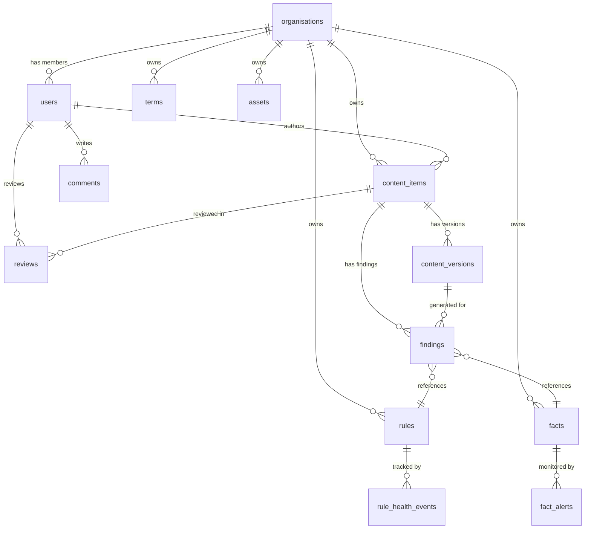

# BrandProof — Backend Data Model

> PostgreSQL schema via Supabase. Uses pgvector for embeddings and Supabase Auth for identity.
> All tables include `org_id` for row-level security isolation.

---

## Entity Relationship Overview



---

## Table Definitions

### `organisations`

| Column | Type | Constraints | Notes |
|---|---|---|---|
| `id` | `uuid` | PK, default `gen_random_uuid()` | — |
| `name` | `text` | NOT NULL | Organisation display name |
| `slug` | `text` | UNIQUE, NOT NULL | URL-friendly identifier |
| `settings` | `jsonb` | DEFAULT `'{}'` | `rules_only_mode`, `ai_provider`, `masking_config` |
| `created_at` | `timestamptz` | DEFAULT `now()` | — |
| `updated_at` | `timestamptz` | DEFAULT `now()` | — |

---

### `users`

> Extends Supabase Auth's `auth.users`. This is a **profiles** table.

| Column | Type | Constraints | Notes |
|---|---|---|---|
| `id` | `uuid` | PK, FK → `auth.users.id` | Matches Supabase Auth user ID |
| `org_id` | `uuid` | FK → `organisations.id`, NOT NULL | RLS key |
| `role` | `text` | NOT NULL, CHECK IN (`creator`, `reviewer`, `brand_manager`, `admin`) | Application role |
| `display_name` | `text` | NOT NULL | — |
| `email` | `text` | NOT NULL | From auth profile |
| `avatar_url` | `text` | NULLABLE | — |
| `is_active` | `boolean` | DEFAULT `true` | Soft disable |
| `created_at` | `timestamptz` | DEFAULT `now()` | — |

**RLS policy:** `org_id = auth.jwt() ->> 'org_id'`

---

### `rules`

| Column | Type | Constraints | Notes |
|---|---|---|---|
| `id` | `uuid` | PK | — |
| `org_id` | `uuid` | FK → `organisations.id`, NOT NULL | RLS key |
| `rule_code` | `text` | NOT NULL | Human-readable ID like `R-21` |
| `category` | `text` | NOT NULL, CHECK IN (`tone`, `terminology`, `messaging`, `visual`, `accessibility`, `claims`) | — |
| `title` | `text` | NOT NULL | Short description |
| `description` | `text` | NOT NULL | Full rule text |
| `severity` | `text` | NOT NULL, CHECK IN (`critical`, `warning`, `info`) | — |
| `good_example` | `text` | NULLABLE | Example of compliant text |
| `bad_example` | `text` | NULLABLE | Example of non-compliant text |
| `source_document` | `text` | NULLABLE | Name of the source PDF/doc |
| `source_page` | `integer` | NULLABLE | Page number in source |
| `source_quote` | `text` | NULLABLE | Exact quote from source |
| `status` | `text` | NOT NULL, DEFAULT `'draft'`, CHECK IN (`draft`, `approved`, `rejected`, `needs_examples`) | Only `approved` rules used in reviews |
| `embedding` | `vector(384)` | NULLABLE | all-MiniLM-L6-v2 embedding |
| `created_by` | `uuid` | FK → `users.id` | — |
| `approved_by` | `uuid` | FK → `users.id`, NULLABLE | — |
| `created_at` | `timestamptz` | DEFAULT `now()` | — |
| `updated_at` | `timestamptz` | DEFAULT `now()` | — |

**Index:** `ivfflat` index on `embedding` using cosine distance.

---

### `facts`

| Column | Type | Constraints | Notes |
|---|---|---|---|
| `id` | `uuid` | PK | — |
| `org_id` | `uuid` | FK → `organisations.id`, NOT NULL | RLS key |
| `fact_code` | `text` | NOT NULL | Human-readable ID like `F-07` |
| `content` | `text` | NOT NULL | The approved factual statement |
| `owner_id` | `uuid` | FK → `users.id`, NOT NULL | Responsible person |
| `source_document` | `text` | NULLABLE | Reference document |
| `valid_until` | `date` | NOT NULL | Expiry date |
| `is_expired` | `boolean` | GENERATED ALWAYS AS (`valid_until < CURRENT_DATE`) STORED | Auto-computed |
| `status` | `text` | NOT NULL, DEFAULT `'active'`, CHECK IN (`active`, `expired`, `retired`) | — |
| `embedding` | `vector(384)` | NULLABLE | — |
| `created_at` | `timestamptz` | DEFAULT `now()` | — |
| `updated_at` | `timestamptz` | DEFAULT `now()` | — |

---

### `terms`

| Column | Type | Constraints | Notes |
|---|---|---|---|
| `id` | `uuid` | PK | — |
| `org_id` | `uuid` | FK → `organisations.id`, NOT NULL | RLS key |
| `preferred_term` | `text` | NOT NULL | The correct term |
| `banned_alternatives` | `text[]` | DEFAULT `'{}'` | Terms that should not be used |
| `notes` | `text` | NULLABLE | Usage context |
| `case_sensitive` | `boolean` | DEFAULT `false` | — |
| `created_at` | `timestamptz` | DEFAULT `now()` | — |
| `updated_at` | `timestamptz` | DEFAULT `now()` | — |

---

### `assets`

| Column | Type | Constraints | Notes |
|---|---|---|---|
| `id` | `uuid` | PK | — |
| `org_id` | `uuid` | FK → `organisations.id`, NOT NULL | RLS key |
| `name` | `text` | NOT NULL | Asset display name |
| `asset_type` | `text` | NOT NULL, CHECK IN (`logo`, `colour`, `font`, `image`) | — |
| `file_path` | `text` | NULLABLE | Path in Supabase Storage |
| `metadata` | `jsonb` | DEFAULT `'{}'` | Hex values for colours, font details, usage notes |
| `usage_notes` | `text` | NULLABLE | When/how to use |
| `created_at` | `timestamptz` | DEFAULT `now()` | — |
| `updated_at` | `timestamptz` | DEFAULT `now()` | — |

---

### `content_items`

| Column | Type | Constraints | Notes |
|---|---|---|---|
| `id` | `uuid` | PK | — |
| `org_id` | `uuid` | FK → `organisations.id`, NOT NULL | RLS key |
| `author_id` | `uuid` | FK → `users.id`, NOT NULL | — |
| `title` | `text` | NOT NULL | — |
| `content_type` | `text` | NOT NULL, CHECK IN (`text`, `social_post`, `email`, `document`, `image`) | — |
| `format` | `text` | NULLABLE, CHECK IN (`plain_text`, `pdf`, `docx`, `pptx`, `png`, `jpg`) | — |
| `status` | `text` | NOT NULL, DEFAULT `'draft'`, CHECK IN (`draft`, `checking`, `checked`, `in_review`, `changes_requested`, `approved`) | State machine |
| `intent_purpose` | `text` | NULLABLE | Intent Lock — purpose |
| `intent_audience` | `text` | NULLABLE | Intent Lock — target audience |
| `intent_key_message` | `text` | NULLABLE | Intent Lock — key message |
| `rules_only_mode` | `boolean` | DEFAULT `false` | Override org-level setting |
| `current_version_id` | `uuid` | FK → `content_versions.id`, NULLABLE | Points to latest version |
| `file_path` | `text` | NULLABLE | Path in Supabase Storage for uploaded files |
| `created_at` | `timestamptz` | DEFAULT `now()` | — |
| `updated_at` | `timestamptz` | DEFAULT `now()` | — |

**Constraint:** Cannot transition to `approved` if `author_id = approver's user_id` (enforced at app layer + trigger).

---

### `content_versions`

| Column | Type | Constraints | Notes |
|---|---|---|---|
| `id` | `uuid` | PK | — |
| `content_item_id` | `uuid` | FK → `content_items.id`, NOT NULL | — |
| `version_number` | `integer` | NOT NULL | Auto-incrementing per content_item |
| `body` | `text` | NOT NULL | The full text at this version |
| `extracted_text` | `text` | NULLABLE | OCR / parsed text for non-text formats |
| `diff_from_previous` | `jsonb` | NULLABLE | diff-match-patch output |
| `created_at` | `timestamptz` | DEFAULT `now()` | — |
| `created_by` | `uuid` | FK → `users.id` | — |

---

### `findings`

| Column | Type | Constraints | Notes |
|---|---|---|---|
| `id` | `uuid` | PK | — |
| `content_item_id` | `uuid` | FK → `content_items.id`, NOT NULL | — |
| `content_version_id` | `uuid` | FK → `content_versions.id`, NOT NULL | — |
| `org_id` | `uuid` | FK → `organisations.id`, NOT NULL | RLS key |
| `check_type` | `text` | NOT NULL, CHECK IN (`rule_check`, `ai_assisted`) | — |
| `category` | `text` | NOT NULL | Same categories as rules |
| `rule_id` | `uuid` | FK → `rules.id`, NULLABLE | — |
| `fact_id` | `uuid` | FK → `facts.id`, NULLABLE | — |
| `severity` | `text` | NOT NULL, CHECK IN (`critical`, `warning`, `info`) | — |
| `title` | `text` | NOT NULL | Short finding description |
| `description` | `text` | NOT NULL | Full explanation |
| `flagged_text` | `text` | NULLABLE | The exact text flagged |
| `evidence_quote` | `text` | NULLABLE | Verbatim quote from rule/fact/source |
| `suggested_fix` | `text` | NULLABLE | — |
| `confidence` | `float` | NULLABLE | AI confidence score, 0.0–1.0 |
| `needs_human_judgement` | `boolean` | DEFAULT `false` | — |
| `status` | `text` | NOT NULL, DEFAULT `'open'`, CHECK IN (`open`, `accepted`, `edited`, `dismissed`) | — |
| `dismiss_reason` | `text` | NULLABLE | Required for critical/warning dismissals |
| `resolved_by` | `uuid` | FK → `users.id`, NULLABLE | — |
| `resolved_at` | `timestamptz` | NULLABLE | — |
| `created_at` | `timestamptz` | DEFAULT `now()` | — |

---

### `reviews`

| Column | Type | Constraints | Notes |
|---|---|---|---|
| `id` | `uuid` | PK | — |
| `content_item_id` | `uuid` | FK → `content_items.id`, NOT NULL | — |
| `org_id` | `uuid` | FK → `organisations.id`, NOT NULL | RLS key |
| `reviewer_id` | `uuid` | FK → `users.id`, NOT NULL | — |
| `decision` | `text` | NULLABLE, CHECK IN (`approved`, `changes_requested`) | — |
| `notes` | `text` | NULLABLE | General review notes |
| `reviewed_at` | `timestamptz` | NULLABLE | — |
| `created_at` | `timestamptz` | DEFAULT `now()` | — |

---

### `comments`

| Column | Type | Constraints | Notes |
|---|---|---|---|
| `id` | `uuid` | PK | — |
| `content_item_id` | `uuid` | FK → `content_items.id`, NOT NULL | — |
| `org_id` | `uuid` | FK → `organisations.id`, NOT NULL | RLS key |
| `finding_id` | `uuid` | FK → `findings.id`, NULLABLE | If commenting on a specific finding |
| `author_id` | `uuid` | FK → `users.id`, NOT NULL | — |
| `body` | `text` | NOT NULL | — |
| `created_at` | `timestamptz` | DEFAULT `now()` | — |
| `updated_at` | `timestamptz` | DEFAULT `now()` | — |

---

### `ai_disclosures`

| Column | Type | Constraints | Notes |
|---|---|---|---|
| `id` | `uuid` | PK | — |
| `content_item_id` | `uuid` | FK → `content_items.id`, NOT NULL | — |
| `content_version_id` | `uuid` | FK → `content_versions.id`, NOT NULL | — |
| `org_id` | `uuid` | FK → `organisations.id`, NOT NULL | RLS key |
| `provider` | `text` | NOT NULL | e.g. `openai`, `gemini`, `local` |
| `masked_input` | `text` | NOT NULL | Exact text sent to AI |
| `raw_response` | `jsonb` | NOT NULL | Full AI response |
| `masking_map` | `jsonb` | NOT NULL | Placeholder → original value mapping |
| `called_at` | `timestamptz` | NOT NULL | — |
| `latency_ms` | `integer` | NULLABLE | Response time |

---

### `audit_log`

| Column | Type | Constraints | Notes |
|---|---|---|---|
| `id` | `uuid` | PK | — |
| `org_id` | `uuid` | FK → `organisations.id`, NOT NULL | RLS key |
| `actor_id` | `uuid` | FK → `users.id`, NOT NULL | — |
| `action` | `text` | NOT NULL | e.g. `content.submitted`, `finding.dismissed`, `rule.approved` |
| `entity_type` | `text` | NOT NULL | e.g. `content_item`, `rule`, `fact` |
| `entity_id` | `uuid` | NOT NULL | — |
| `old_state` | `jsonb` | NULLABLE | — |
| `new_state` | `jsonb` | NULLABLE | — |
| `metadata` | `jsonb` | DEFAULT `'{}'` | Extra context |
| `created_at` | `timestamptz` | DEFAULT `now()` | Immutable |

**Note:** Audit log rows are **insert-only** — never updated or deleted.

---

### `rule_health_events`

| Column | Type | Constraints | Notes |
|---|---|---|---|
| `id` | `uuid` | PK | — |
| `org_id` | `uuid` | FK → `organisations.id`, NOT NULL | — |
| `rule_id` | `uuid` | FK → `rules.id`, NOT NULL | — |
| `event_type` | `text` | NOT NULL, CHECK IN (`triggered`, `accepted`, `dismissed`, `overridden`) | — |
| `content_item_id` | `uuid` | FK → `content_items.id`, NULLABLE | — |
| `actor_id` | `uuid` | FK → `users.id`, NULLABLE | — |
| `reason` | `text` | NULLABLE | For dismissals/overrides |
| `created_at` | `timestamptz` | DEFAULT `now()` | — |

---

### `notifications`

| Column | Type | Constraints | Notes |
|---|---|---|---|
| `id` | `uuid` | PK | — |
| `org_id` | `uuid` | FK → `organisations.id`, NOT NULL | — |
| `user_id` | `uuid` | FK → `users.id`, NOT NULL | Recipient |
| `type` | `text` | NOT NULL | e.g. `review_submitted`, `changes_requested`, `fact_expiring` |
| `title` | `text` | NOT NULL | — |
| `body` | `text` | NULLABLE | — |
| `entity_type` | `text` | NULLABLE | — |
| `entity_id` | `uuid` | NULLABLE | — |
| `is_read` | `boolean` | DEFAULT `false` | — |
| `created_at` | `timestamptz` | DEFAULT `now()` | — |

---

## Key Indexes

| Table | Index | Type | Purpose |
|---|---|---|---|
| `rules` | `embedding` | ivfflat (cosine) | Semantic search for nearest rules |
| `facts` | `embedding` | ivfflat (cosine) | Claim matching |
| `facts` | `valid_until` | btree | Expiry queries |
| `content_items` | `(org_id, status)` | btree | Listing by status |
| `findings` | `(content_item_id, status)` | btree | Finding resolution |
| `audit_log` | `(org_id, created_at)` | btree | Chronological queries |
| `notifications` | `(user_id, is_read)` | btree | Unread count |

---

## Row-Level Security (RLS) Pattern

All tables with `org_id` follow this pattern:

```sql
-- Enable RLS
ALTER TABLE <table> ENABLE ROW LEVEL SECURITY;

-- Select policy
CREATE POLICY "Users can view own org data"
  ON <table> FOR SELECT
  USING (org_id = (auth.jwt() ->> 'org_id')::uuid);

-- Insert policy
CREATE POLICY "Users can insert own org data"
  ON <table> FOR INSERT
  WITH CHECK (org_id = (auth.jwt() ->> 'org_id')::uuid);

-- Update/Delete policies follow role-based logic
```
