# BrandProof — Backend Development Plan

> Maps the backend work across the three hackathon rounds.
> Each round has clear sprints and exit criteria.

---

## Round Overview

```mermaid
gantt
    title Backend Development Roadmap
    dateFormat X
    axisFormat %s

    section Round 1 – Plan
    Data model design           :done, r1a, 0, 1
    API contract draft          :done, r1b, 0, 1
    Project scaffolding         :r1c, 1, 2
    Supabase setup              :r1d, 1, 2
    Proof-of-concept tests      :r1e, 2, 3

    section Round 2 – Prototype
    Sprint 1: Auth & CRUD       :r2a, 3, 5
    Sprint 2: Review engine     :r2b, 5, 7
    Sprint 3: Workflow           :r2c, 7, 9

    section Round 3 – Polish
    Rulebook Compiler           :r3a, 9, 10
    DOCX/PDF input              :r3b, 10, 11
    Insights & export           :r3c, 11, 12
    Golden tests & tuning       :r3d, 12, 13
    Deployment & demo           :r3e, 13, 14
```

---

## Round 1 — Plan & Prove (Current)

**Focus:** Validate that the core AI integration works and the data model is sound.

| # | Deliverable | Details | Status |
|---|---|---|---|
| 1.1 | Data model design | All tables, columns, RLS policies documented in `data-model.md` | ✅ |
| 1.2 | API contract | All endpoints documented in `api-contract.md` | ✅ |
| 1.3 | Project scaffold | FastAPI project with folder structure from `spec.md` | 🔲 |
| 1.4 | Supabase project | Create project, enable pgvector, create initial tables | 🔲 |
| 1.5 | Proof-of-concept: Claim matching | Embed 5–10 sample facts, run 5 sample claims, verify cosine similarity finds correct matches | 🔲 |
| 1.6 | Proof-of-concept: AI JSON validation | Send one sample text to LLM with the structured prompt, validate output against Pydantic schema | 🔲 |
| 1.7 | Sample brand data | JSON fixtures for a fictional company (rules, facts, terms, colour palette) | 🔲 |

**Exit criteria:** Plan submitted. Claim matching test passes on sample facts.

---

## Round 2 — Working Prototype

### Sprint 1: Foundation (Auth, Roles, CRUD)

| # | Task | Priority | Dependencies |
|---|---|---|---|
| 2.1 | Auth middleware — JWT validation from Supabase | Must | Supabase setup |
| 2.2 | User profiles CRUD + role enforcement | Must | 2.1 |
| 2.3 | Organisation settings endpoint | Must | 2.1 |
| 2.4 | Rules CRUD (manual entry) | Must | 2.1 |
| 2.5 | Facts CRUD + CSV import | Must | 2.1 |
| 2.6 | Terms CRUD + CSV import | Must | 2.1 |
| 2.7 | Assets upload + listing | Must | 2.1 |
| 2.8 | Content items CRUD + version creation | Must | 2.1 |
| 2.9 | Embedding generation on rule/fact create/update | Must | 2.4, 2.5 |

**Sprint 1 exit:** All setup screens have working API endpoints. Frontend can create rules, facts, terms, assets.

### Sprint 2: Review Engine

| # | Task | Priority | Dependencies |
|---|---|---|---|
| 2.10 | Review engine orchestrator | Must | 2.8 |
| 2.11 | Terminology check (spaCy PhraseMatcher) | Must | 2.6, 2.10 |
| 2.12 | Banned-word check | Must | 2.6, 2.10 |
| 2.13 | Readability check (textstat) | Must | 2.10 |
| 2.14 | Colour palette check (Pillow + scikit-learn) | Must | 2.7, 2.10 |
| 2.15 | WCAG contrast check | Must | 2.10 |
| 2.16 | Alt text check | Must | 2.10 |
| 2.17 | Masking service | Must | — |
| 2.18 | AI Gateway — provider abstraction | Must | 2.17 |
| 2.19 | AI tone check | Must | 2.18, 2.4 |
| 2.20 | Claim Passport — extraction + matching | Must | 2.18, 2.5, 2.9 |
| 2.21 | AI disclosure record creation | Must | 2.18 |
| 2.22 | Finding storage + endpoint | Must | 2.10 |

**Sprint 2 exit:** A text post and an image can be reviewed. At least one finding of each type appears.

### Sprint 3: Workflow

| # | Task | Priority | Dependencies |
|---|---|---|---|
| 2.23 | Content state machine enforcement | Must | 2.8 |
| 2.24 | Intent Lock storage + validation | Must | 2.8 |
| 2.25 | Suggestion generation (AI) with Intent Lock | Must | 2.18, 2.24 |
| 2.26 | Finding resolution (accept/edit/dismiss) | Must | 2.22 |
| 2.27 | Submit for review workflow | Must | 2.23 |
| 2.28 | Review queue + decision endpoint | Must | 2.27 |
| 2.29 | Comments on content and findings | Must | 2.22 |
| 2.30 | Version history + diff endpoint | Must | 2.8 |
| 2.31 | Audit log — write on every state change | Must | — |
| 2.32 | In-app notifications | Must | — |

**Sprint 3 exit:** Complete path from draft → checked → in_review → approved works end-to-end.

---

## Round 3 — Complete Product & Demo

| # | Task | Priority | Dependencies |
|---|---|---|---|
| 3.1 | Rulebook Compiler (PDF → proposed rules) | Must | 2.4, Parsing |
| 3.2 | PDF text extraction (PyMuPDF) | Must | — |
| 3.3 | DOCX text extraction (python-docx) | Must | — |
| 3.4 | Image OCR (Tesseract) | Must | — |
| 3.5 | Meaning check (before/after key points) | Must | 2.25 |
| 3.6 | Required-text check (e.g. legal disclaimer) | Must | 2.10 |
| 3.7 | Resolution check (image) | Must | 2.10 |
| 3.8 | Rule Health dashboard endpoint | Must | 2.31 |
| 3.9 | Recurring-mistakes insights endpoint | Must | 2.31 |
| 3.10 | Aggregated dashboard stats endpoint | Must | — |
| 3.11 | PDF approval record export | Should | 2.30 |
| 3.12 | Golden test set — build 40–50 fixtures | Must | 2.10 |
| 3.13 | Golden test runner — measure detection, precision, explainability | Must | 3.12 |
| 3.14 | Tune prompts and thresholds | Must | 3.13 |
| 3.15 | PPTX extraction (python-pptx) | Should | — |
| 3.16 | Docker setup for local development | Must | — |
| 3.17 | Deploy to Render | Must | — |
| 3.18 | Demo data seeding script | Must | — |
| 3.19 | Logo misuse detection (image model) | Could | — |
| 3.20 | Email notifications | Could | — |
| 3.21 | AI provider choice per-org | Could | 2.18 |

**Exit criteria:** Live demo of all Must features on deployed app. Golden test results ready to present.

---

## Risk Mitigation per Round

| Round | Risk | Mitigation |
|---|---|---|
| 2 | AI integration is flaky | Build fixed checks first; AI checks are additive |
| 2 | Supabase RLS is complex | Start with simple policies; test with multiple orgs early |
| 3 | Rulebook Compiler quality | Manual entry and CSV always work; compiler is an enhancer |
| 3 | Golden test scores are low | Focus on precision over recall; tune prompts iteratively |
| 3 | Deployment issues | Docker-compose runs locally; Render deploy is well-documented |

---

## Cut Order (if behind schedule)

1. **Could** features: logo misuse detection, email notifications, AI provider choice per-org
2. **Should** features: PPTX extraction, PDF approval record
3. **Polish items** in Round 3: meaning check refinement, dashboard stats
4. **Never cut:** fixed checks, claim passport, review workflow, audit log, privacy/masking
