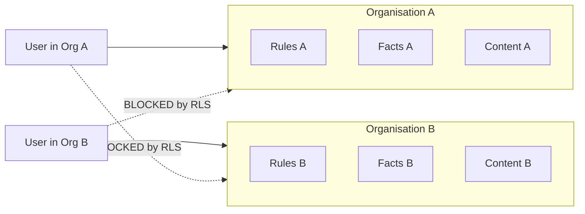
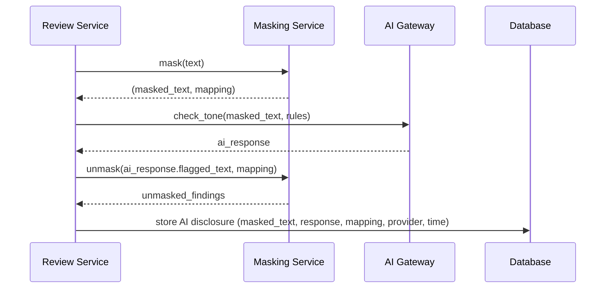
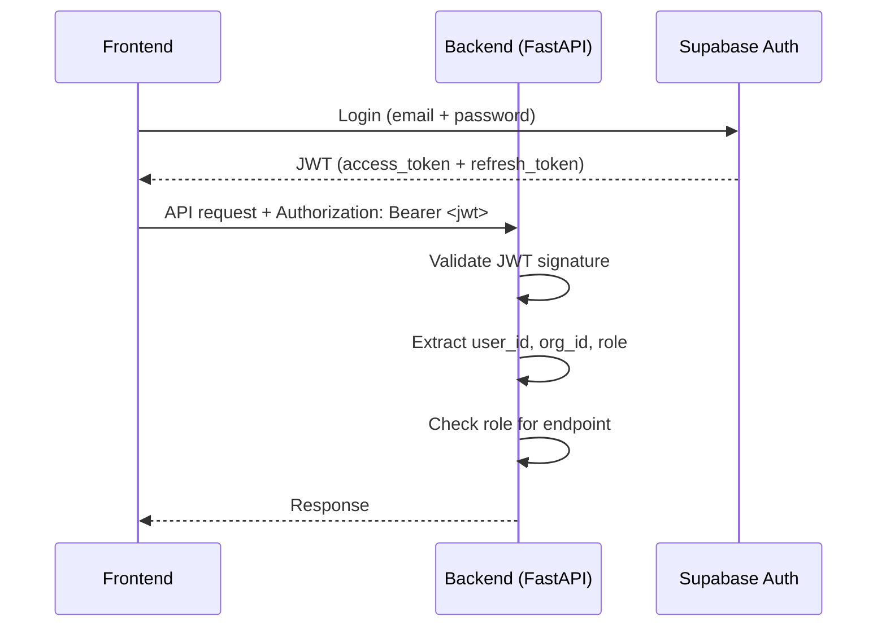

# BrandProof — Privacy & Security Specification

> Detailed design for data isolation, masking, disclosure, and security measures.

---

## 1. Multi-Tenant Isolation

### 1.1 Organisation Boundaries

Every piece of data belongs to exactly one organisation. There is no concept of "shared" data between orgs.



### 1.2 Row-Level Security Policies

Every table with `org_id` has these RLS policies:

```sql
-- Base read policy (all roles)
CREATE POLICY "org_isolation_select" ON <table>
  FOR SELECT USING (org_id = (auth.jwt() ->> 'org_id')::uuid);

-- Base insert policy (all roles)
CREATE POLICY "org_isolation_insert" ON <table>
  FOR INSERT WITH CHECK (org_id = (auth.jwt() ->> 'org_id')::uuid);

-- Update policy (role-restricted)
CREATE POLICY "org_isolation_update" ON <table>
  FOR UPDATE USING (org_id = (auth.jwt() ->> 'org_id')::uuid)
  WITH CHECK (org_id = (auth.jwt() ->> 'org_id')::uuid);

-- Delete policy (role-restricted)
CREATE POLICY "org_isolation_delete" ON <table>
  FOR DELETE USING (org_id = (auth.jwt() ->> 'org_id')::uuid);
```

**Additional role-based policies:**

| Table | Write Roles | Notes |
|---|---|---|
| `rules` | brand_manager | Only brand_manager can create/edit rules |
| `facts` | brand_manager | — |
| `terms` | brand_manager | — |
| `assets` | brand_manager | — |
| `content_items` | creator, brand_manager | Creators can only update their own |
| `reviews` | reviewer, brand_manager | — |
| `users` | admin | — |
| `organisations` | admin | Settings only |
| `audit_log` | (insert-only by service role) | No user can delete audit entries |

---

## 2. Masking Pipeline

### 2.1 What Gets Masked

| Pattern | Detection | Placeholder |
|---|---|---|
| Confidential-tagged text | `[CONFIDENTIAL]...[/CONFIDENTIAL]` markers | `[CONFIDENTIAL_N]` |
| Email addresses | Regex: `[a-zA-Z0-9._%+-]+@[a-zA-Z0-9.-]+\.[a-zA-Z]{2,}` | `[EMAIL_N]` |
| Phone numbers | Regex: `(\+?\d{1,3}[-.\s]?)?\(?\d{1,4}\)?[-.\s]?\d{1,4}[-.\s]?\d{1,9}` | `[PHONE_N]` |
| Custom org patterns | Configurable regex in `org.settings.masking_config.custom_patterns` | `[CUSTOM_N]` |

### 2.2 Masking Flow



### 2.3 Masking Rules

1. **Order matters:** Confidential tags first, then emails, then phone numbers.
2. **Numbering is sequential:** `[EMAIL_1]`, `[EMAIL_2]`, etc., in order of appearance.
3. **The mapping is stored:** Per-review, in `ai_disclosures.masking_map` as JSON.
4. **Unmasking is for display only:** The AI never sees original values.
5. **Idempotent:** Masking the same text twice produces the same output.

---

## 3. AI-Use Disclosure

### 3.1 Disclosure Record

Every AI API call creates one `ai_disclosures` row:

```json
{
  "provider": "openai",
  "masked_input": "Our platform [CONFIDENTIAL_1] with [EMAIL_1] support.",
  "raw_response": { "findings": [...] },
  "masking_map": {
    "[CONFIDENTIAL_1]": "reduces costs by 45%",
    "[EMAIL_1]": "john@acme.com"
  },
  "called_at": "2026-10-22T14:30:00Z",
  "latency_ms": 1234
}
```

### 3.2 Disclosure Panel (API Response)

The `GET /content/:id/ai-disclosures` endpoint returns all disclosures for the frontend to display:

- Provider name and icon
- Exact masked text that was sent (user can see what AI received)
- Timestamp
- Whether findings were generated from this call
- "Rules only" indicator if no AI was used

### 3.3 "Rules Only" Mode

| Setting | Effect |
|---|---|
| `org.settings.rules_only_mode = true` | All content in the org skips AI checks |
| `content_item.rules_only_mode = true` | This specific content skips AI checks |
| Either is true | No `ai_disclosures` record is created; disclosure panel shows "No external AI service was used" |

---

## 4. File Security

### 4.1 Storage Structure

```
supabase-storage/
├── {org_id}/
│   ├── uploads/          # User-uploaded content (PDFs, DOCX, images)
│   │   └── {content_id}/{filename}
│   ├── assets/           # Brand assets (logos, fonts, etc.)
│   │   └── {asset_id}/{filename}
│   └── exports/          # Generated PDF approval records
│       └── {content_id}/approval_{timestamp}.pdf
```

### 4.2 Access Control

- **No public URLs.** All files are in **private buckets**.
- Access via **signed URLs** with configurable TTL (default: 1 hour, max: 24 hours).
- Signed URLs are generated server-side; the frontend never accesses Storage directly.
- RLS on the `assets` and `content_items` tables ensures users can only request signed URLs for their org's files.

### 4.3 Upload Validation

| Check | Rule |
|---|---|
| File size | Max 50 MB (configurable) |
| MIME type | Whitelist: `application/pdf`, `application/vnd.openxmlformats-officedocument.*`, `image/png`, `image/jpeg` |
| File extension | Must match MIME type |
| Filename sanitisation | Strip special characters, limit length |

---

## 5. API Security

### 5.1 Authentication Flow



### 5.2 JWT Claims

```json
{
  "sub": "user-uuid",
  "org_id": "org-uuid",
  "role": "creator",
  "email": "user@example.com",
  "exp": 1700000000,
  "iat": 1699996400
}
```

### 5.3 Secret Management

| Secret | Storage | Access |
|---|---|---|
| Supabase URL | Environment variable | Server only |
| Supabase service key | Environment variable | Server only, never in responses |
| JWT secret | Supabase managed | Verified by middleware |
| OpenAI/Gemini API keys | Environment variable | Server only, never logged |
| Database password | Supabase managed | Never accessed directly |

**Rules:**
- Secrets never appear in logs, error messages, or API responses.
- Secrets never appear in frontend bundles or client-accessible code.
- `.env` is `.gitignore`d. Only `.env.example` is committed.

---

## 6. Audit Trail

### 6.1 What Gets Logged

| Event | Actors | Logged Data |
|---|---|---|
| Content created | Creator | content_id, title, type |
| Content checked | System | content_id, findings_count |
| Finding resolved | Creator/Reviewer | finding_id, old_status → new_status, reason |
| Content submitted for review | Creator | content_id |
| Review decision | Reviewer | content_id, decision, notes |
| Content approved | Brand Manager | content_id, approver_id |
| Rule created/edited | Brand Manager | rule_id, changes |
| Rule approved/rejected | Brand Manager | rule_id, old_status → new_status |
| Fact created/edited | Brand Manager | fact_id, changes |
| User invited | Admin | user_id, role |
| Settings changed | Admin | changed_fields |

### 6.2 Immutability

- Audit log rows are **insert-only**.
- No UPDATE or DELETE policies exist on the `audit_log` table.
- The `created_at` timestamp is server-generated and cannot be overridden.
- The backend uses a **service-role** connection to insert audit entries (bypasses RLS for writes, but reads are still org-scoped).
