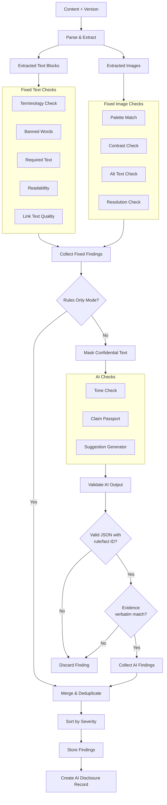
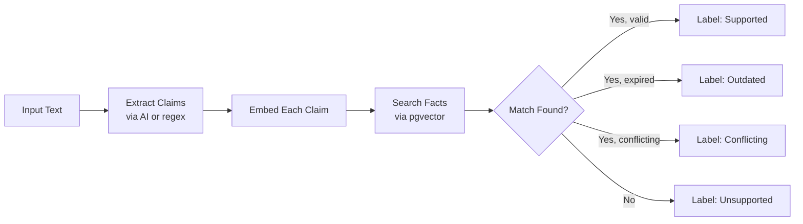
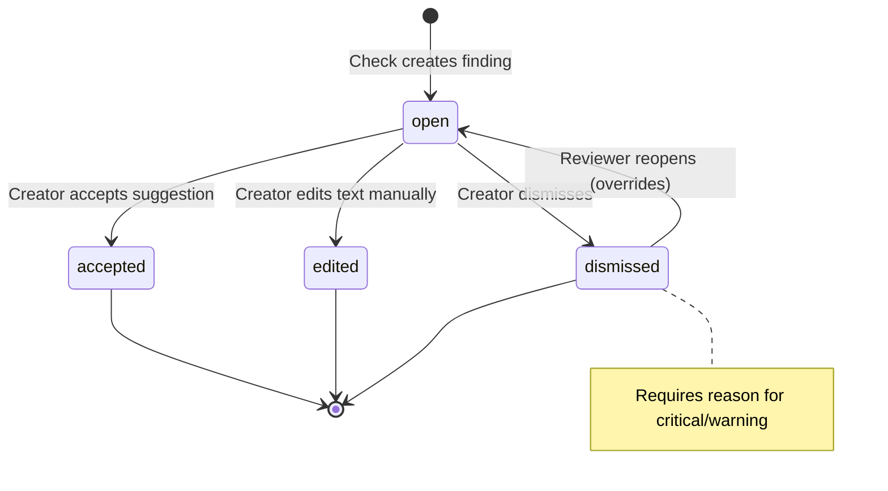

# BrandProof — Review Engine Specification

> Detailed design of the hybrid review engine — the core intelligence of BrandProof.
> Covers the fixed-check pipeline, AI-check pipeline, orchestration, and finding lifecycle.

---

## 1. Engine Architecture



---

## 2. Fixed Checks — Detailed Specifications

### 2.1 Terminology Check

**Library:** spaCy PhraseMatcher  
**Input:** extracted text, organisation's terminology list  
**Logic:**

1. Load all `banned_alternatives` from the org's terms into a PhraseMatcher.
2. Run the matcher against the document.
3. For each match, create a finding pointing to the term's `preferred_term`.

**Finding output:**
```json
{
  "check_type": "rule_check",
  "category": "terminology",
  "severity": "warning",
  "title": "Non-preferred term used",
  "flagged_text": "client",
  "evidence_quote": "Preferred term: 'customer'. Banned alternatives: 'client', 'user'.",
  "suggested_fix": "customer"
}
```

### 2.2 Banned-Word Check

**Library:** regex  
**Input:** extracted text, org's banned word list (subset of terminology where `preferred_term` is null)  
**Logic:** Regex word-boundary match `\b{word}\b` for each banned word.

### 2.3 Required-Text Check

**Library:** string search  
**Input:** extracted text, org's required text patterns (e.g. legal disclaimers)  
**Logic:** Check that each required text snippet appears somewhere in the content. If missing, flag.

**Finding output:**
```json
{
  "check_type": "rule_check",
  "category": "messaging",
  "severity": "critical",
  "title": "Required disclaimer missing",
  "flagged_text": null,
  "evidence_quote": "Rule R-45: All promotional emails must include the legal disclaimer.",
  "suggested_fix": "Add: 'Terms and conditions apply. See example.com/terms for details.'"
}
```

### 2.4 Readability Check

**Library:** textstat  
**Input:** extracted text  
**Logic:**

1. Calculate Flesch-Kincaid grade level.
2. Compare against the org's configured target (default: grade 8).
3. If grade > target + 2, flag as too complex.

**Metrics computed:** Flesch Reading Ease, Flesch-Kincaid Grade, Gunning Fog Index.

### 2.5 Colour Palette Check

**Library:** Pillow, scikit-learn (KMeans)  
**Input:** image, org's approved colour palette  
**Logic:**

1. Extract top-N dominant colours from the image using KMeans clustering.
2. For each dominant colour, compute the minimum CIE ΔE distance to the nearest palette colour.
3. If ΔE > threshold (default 15), flag the colour as off-brand.

### 2.6 WCAG Contrast Check

**Library:** WCAG contrast formula  
**Input:** foreground and background colour pairs (from images or document styles)  
**Logic:**

1. Compute relative luminance for each colour.
2. Compute contrast ratio: `(L1 + 0.05) / (L2 + 0.05)`.
3. AA requires ≥ 4.5:1 for normal text, ≥ 3:1 for large text.
4. Flag pairs below the threshold.

### 2.7 Alt-Text Check

**Input:** images in the content  
**Logic:** If an image has no `alt` attribute (HTML) or no alt text field, flag it.

### 2.8 Image Resolution Check

**Library:** Pillow  
**Input:** images  
**Logic:** Flag images below minimum dimensions (default: 300×300 for web, 1200×630 for social).

### 2.9 Link Text Quality Check

**Library:** regex  
**Input:** extracted text with links  
**Logic:** Flag links with vague text like "click here", "read more", "learn more", "here", "link".

---

## 3. AI Checks — Detailed Specifications

### 3.1 Tone Check

**Purpose:** Verify that the draft's tone matches the rulebook's guidelines.

**Prompt structure:**
```
You are a brand tone reviewer. Compare the following text against the brand's tone rules.
For each tone violation, return a JSON finding with the exact flagged text and the rule_id.

RULES:
{rules with good_example and bad_example, category = 'tone'}

TEXT TO REVIEW:
{masked text}

Respond ONLY with valid JSON in this format:
{schema}
```

**Pydantic response model:**
```python
class AIToneFinding(BaseModel):
    rule_id: str                    # Must match an existing rule
    flagged_text: str               # Must appear verbatim in the input
    explanation: str
    severity: Literal["critical", "warning", "info"]
    suggested_fix: str | None
    confidence: float               # 0.0 to 1.0

class AIToneResponse(BaseModel):
    findings: list[AIToneFinding]
```

### 3.2 Claim Passport

**Purpose:** Extract claims and match against the Approved Facts Vault.

**Pipeline:**



**Claim extraction prompt:**
```
Extract all factual or promotional claims from the following text.
A claim is any statement that asserts a measurable fact, comparison, or benefit.
Return each claim as a separate string.

TEXT:
{masked text}

Respond with JSON: {"claims": ["claim 1", "claim 2", ...]}
```

**Matching logic:**
1. Embed each extracted claim using `all-MiniLM-L6-v2`.
2. Query `facts` table with pgvector cosine similarity, top-3 results.
3. If best match similarity ≥ 0.75:
   - Check `valid_until`: if expired → **outdated**
   - Check semantic alignment: if contradictory → **conflicting**
   - Otherwise → **supported**
4. If no match ≥ 0.75 → **unsupported**

### 3.3 Suggestion Generator

**Purpose:** Generate fix suggestions that respect the Intent Lock.

**Prompt structure:**
```
Suggest a fix for the following issue in brand content.

ORIGINAL TEXT: {flagged text}
ISSUE: {finding description}
RULE/FACT: {rule or fact content}

INTENT LOCK (do NOT violate):
- Purpose: {purpose}
- Audience: {audience}
- Key message: {key_message}

Return JSON: {"suggested_fix": "...", "explanation": "..."}
```

---

## 4. Finding Lifecycle



---

## 5. Deduplication Rules

When merging fixed-check and AI-check findings:

1. If a fixed check and an AI check flag the **same text span** for the **same category**, keep the fixed-check finding (more reliable) and discard the AI finding.
2. If two AI findings flag overlapping text spans, keep the one with higher confidence.
3. Findings for different categories on the same text span are kept (e.g. a term can be both banned AND an accessibility issue).

---

## 6. Confidence & Human Judgement

| Confidence Range | Label | Display |
|---|---|---|
| ≥ 0.85 | High confidence | Shown as a definitive finding |
| 0.60 – 0.84 | Medium confidence | Shown with "AI-assisted" badge |
| < 0.60 | Low confidence | Shown as "Needs human judgement" with dimmed styling |

Findings below 0.40 confidence are **discarded** entirely.
