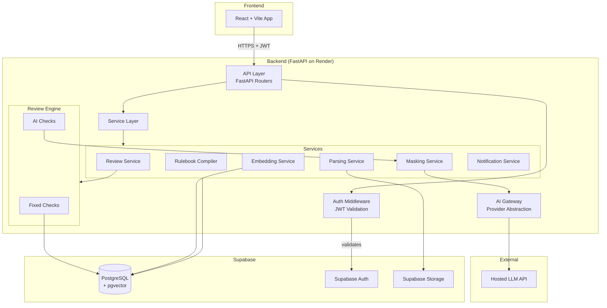
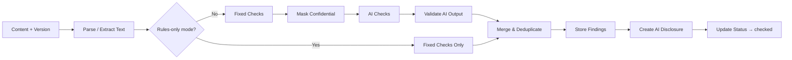

# BrandProof — Backend Technical Specification

> Detailed technical design for the FastAPI backend service.
> Covers architecture, module structure, service layers, and integration patterns.

---

## 1. Architecture Overview



---

## 2. Project Structure

```
backend/
├── app/
│   ├── __init__.py
│   ├── main.py                    # FastAPI app factory
│   ├── config.py                  # Settings from env vars
│   ├── dependencies.py            # Shared dependency injection
│   │
│   ├── api/                       # API routers
│   │   ├── __init__.py
│   │   ├── auth.py
│   │   ├── users.py
│   │   ├── org_settings.py
│   │   ├── rules.py
│   │   ├── facts.py
│   │   ├── terms.py
│   │   ├── assets.py
│   │   ├── content.py
│   │   ├── findings.py
│   │   ├── reviews.py
│   │   ├── comments.py
│   │   ├── notifications.py
│   │   ├── insights.py
│   │   └── export.py
│   │
│   ├── models/                    # Pydantic models (request / response / internal)
│   │   ├── __init__.py
│   │   ├── auth.py
│   │   ├── user.py
│   │   ├── organisation.py
│   │   ├── rule.py
│   │   ├── fact.py
│   │   ├── term.py
│   │   ├── asset.py
│   │   ├── content.py
│   │   ├── finding.py
│   │   ├── review.py
│   │   ├── comment.py
│   │   ├── ai_disclosure.py
│   │   ├── notification.py
│   │   ├── audit.py
│   │   ├── insight.py
│   │   └── common.py              # Envelope, pagination, error models
│   │
│   ├── services/                  # Business logic layer
│   │   ├── __init__.py
│   │   ├── auth_service.py
│   │   ├── user_service.py
│   │   ├── org_service.py
│   │   ├── rule_service.py
│   │   ├── fact_service.py
│   │   ├── term_service.py
│   │   ├── asset_service.py
│   │   ├── content_service.py
│   │   ├── review_service.py       # Orchestrates the full review pipeline
│   │   ├── finding_service.py
│   │   ├── notification_service.py
│   │   ├── audit_service.py
│   │   ├── insight_service.py
│   │   └── export_service.py
│   │
│   ├── engine/                    # Review engine
│   │   ├── __init__.py
│   │   ├── orchestrator.py         # Runs checks in order, collects findings
│   │   ├── fixed_checks/
│   │   │   ├── __init__.py
│   │   │   ├── terminology.py      # spaCy PhraseMatcher
│   │   │   ├── banned_words.py
│   │   │   ├── required_text.py
│   │   │   ├── readability.py      # textstat
│   │   │   ├── colour_check.py     # Palette match
│   │   │   ├── contrast_check.py   # WCAG formula
│   │   │   ├── alt_text_check.py
│   │   │   ├── resolution_check.py
│   │   │   └── link_text_check.py
│   │   ├── ai_checks/
│   │   │   ├── __init__.py
│   │   │   ├── tone_check.py
│   │   │   ├── claim_passport.py
│   │   │   └── suggestion_gen.py
│   │   └── schemas/
│   │       ├── __init__.py
│   │       └── ai_response.py      # Pydantic schemas for AI JSON output
│   │
│   ├── parsing/                   # Document & image parsing
│   │   ├── __init__.py
│   │   ├── parser_factory.py
│   │   ├── pdf_parser.py           # PyMuPDF
│   │   ├── docx_parser.py          # python-docx
│   │   ├── pptx_parser.py          # python-pptx
│   │   ├── image_parser.py         # Pillow + Tesseract
│   │   └── models.py               # ExtractedContent, TextBlock, ExtractedImage
│   │
│   ├── ai/                        # AI provider abstraction
│   │   ├── __init__.py
│   │   ├── base.py                 # AIService ABC
│   │   ├── openai_provider.py
│   │   ├── gemini_provider.py
│   │   ├── local_provider.py
│   │   └── masking.py              # MaskingService
│   │
│   ├── embeddings/                # Embedding generation & search
│   │   ├── __init__.py
│   │   ├── embedder.py             # sentence-transformers wrapper
│   │   └── search.py               # pgvector similarity queries
│   │
│   ├── db/                        # Database layer
│   │   ├── __init__.py
│   │   ├── client.py               # Supabase client setup
│   │   ├── repositories/           # Data access objects
│   │   │   ├── __init__.py
│   │   │   ├── rule_repo.py
│   │   │   ├── fact_repo.py
│   │   │   ├── term_repo.py
│   │   │   ├── asset_repo.py
│   │   │   ├── content_repo.py
│   │   │   ├── finding_repo.py
│   │   │   ├── review_repo.py
│   │   │   ├── comment_repo.py
│   │   │   ├── notification_repo.py
│   │   │   ├── audit_repo.py
│   │   │   └── insight_repo.py
│   │   └── migrations/             # SQL migration files
│   │       ├── 001_initial_schema.sql
│   │       ├── 002_enable_pgvector.sql
│   │       ├── 003_rls_policies.sql
│   │       └── ...
│   │
│   ├── middleware/
│   │   ├── __init__.py
│   │   ├── auth.py                 # JWT extraction & validation
│   │   ├── error_handler.py        # Global error → envelope conversion
│   │   └── logging.py              # Request/response logging
│   │
│   └── utils/
│       ├── __init__.py
│       ├── diff.py                 # diff-match-patch wrapper
│       ├── colour.py               # Colour distance, WCAG contrast
│       ├── csv_import.py           # Generic CSV parser
│       └── pagination.py           # Cursor-based pagination helpers
│
├── tests/
│   ├── conftest.py
│   ├── golden/                    # Golden test set fixtures
│   │   ├── claim_outdated.json
│   │   ├── claim_unsupported.json
│   │   ├── banned_term.json
│   │   ├── tone_mismatch.json
│   │   └── ...
│   ├── unit/
│   │   ├── test_terminology.py
│   │   ├── test_banned_words.py
│   │   ├── test_readability.py
│   │   ├── test_colour_check.py
│   │   ├── test_contrast_check.py
│   │   ├── test_claim_passport.py
│   │   ├── test_masking.py
│   │   ├── test_diff.py
│   │   └── ...
│   ├── integration/
│   │   ├── test_auth_api.py
│   │   ├── test_rules_api.py
│   │   ├── test_content_api.py
│   │   ├── test_review_pipeline.py
│   │   └── ...
│   └── golden_test_runner.py      # Runs all golden set tests, reports metrics
│
├── Dockerfile
├── docker-compose.yml
├── requirements.txt
├── .env.example
├── pyproject.toml
└── README.md
```

---

## 3. Key Design Patterns

### 3.1 Layered Architecture

```
API Router → Service → Repository → Database
              ↓
           Engine (for review-related services)
              ↓
           AI Gateway (for AI checks only)
```

- **API Routers** — HTTP concerns only: request parsing, response formatting, auth checks.
- **Services** — Business logic, state transitions, validation, orchestration.
- **Repositories** — Database queries via Supabase client. One repo per table.
- **Engine** — Review-specific logic, independent of HTTP context.

### 3.2 Dependency Injection

FastAPI's `Depends()` is used for:
- `get_current_user` — extracts and validates JWT, returns `CurrentUser` model.
- `get_db` — returns Supabase client instance.
- `require_role(role)` — factory that returns a dependency checking the user's role.

### 3.3 Review Engine Pipeline



### 3.4 AI Provider Interface

```python
class AIService(ABC):
    @abstractmethod
    async def check_tone(self, text: str, rules: list[Rule]) -> list[AIFinding]: ...

    @abstractmethod
    async def check_claims(self, claims: list[str], facts: list[Fact]) -> list[AIFinding]: ...

    @abstractmethod
    async def suggest_fix(self, text: str, finding: Finding, intent: IntentLock) -> Suggestion: ...
```

Each provider implements this interface. The active provider is resolved from org settings.

---

## 4. Configuration (Environment Variables)

| Variable | Purpose | Example |
|---|---|---|
| `SUPABASE_URL` | Supabase project URL | `https://xxx.supabase.co` |
| `SUPABASE_SERVICE_KEY` | Service role key (server only) | `eyJ...` |
| `SUPABASE_JWT_SECRET` | JWT verification secret | `super-secret-jwt-token` |
| `OPENAI_API_KEY` | OpenAI API key (optional) | `sk-...` |
| `GEMINI_API_KEY` | Gemini API key (optional) | `AIza...` |
| `DEFAULT_AI_PROVIDER` | Default AI provider | `openai` |
| `EMBEDDING_MODEL` | Sentence-transformers model name | `all-MiniLM-L6-v2` |
| `TESSERACT_CMD` | Path to Tesseract binary | `/usr/bin/tesseract` |
| `LOG_LEVEL` | Logging level | `INFO` |
| `CORS_ORIGINS` | Allowed frontend origins | `https://brandproof.vercel.app` |
| `MAX_UPLOAD_SIZE_MB` | Max file upload size | `50` |

---

## 5. Error Handling Strategy

1. Services raise typed exceptions (e.g., `EntityNotFoundError`, `InvalidTransitionError`).
2. A global exception handler in middleware catches these and converts to the standard error envelope.
3. Unexpected exceptions return `500` with `INTERNAL_ERROR` code and are logged with full traceback.
4. AI provider errors are caught and converted to `AI_SERVICE_UNAVAILABLE`; the review continues with fixed-check results only.

---

## 6. Performance Considerations

| Concern | Strategy |
|---|---|
| Embedding generation latency | Batch embed on rule/fact create/update; single embed per claim at review time |
| Large document parsing | Stream-parse PDFs; limit to 100 pages for MVP |
| AI API latency | 30s timeout per call; return fixed-check results immediately if AI hangs |
| Database queries | Indexes on all FK columns and common query patterns (see data-model.md) |
| File uploads | Stream to Supabase Storage; validate MIME type before processing |
| Concurrent reviews | Each review operates on a specific version_id, avoiding conflicts |

---

## 7. Security Measures

| Measure | Implementation |
|---|---|
| Input validation | Pydantic models on every request body |
| SQL injection | Supabase client uses parameterised queries |
| File upload validation | MIME type check, file size limit, virus scan (stretch) |
| Rate limiting | Per-user rate limits via middleware (Could priority) |
| CORS | Strict origin whitelist |
| HTTPS | Enforced by Render deployment |
| Secrets management | Environment variables only; never logged |
