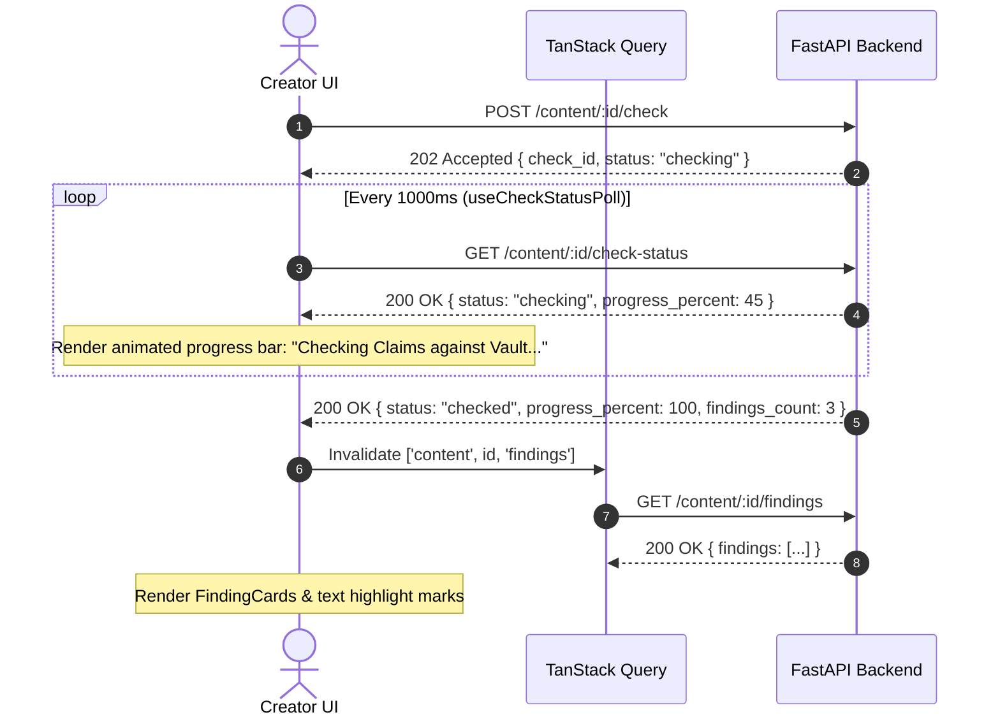

# BrandProof — Frontend API Integration & Mapping

> Specification for frontend API communication, client wrappers, TanStack Query hooks, payload transformations, cache invalidation, and error handling.
> Aligned with `docs/backend/api-contract.md`.

---

## 1. Network Client Architecture

All network traffic routes through a unified `apiClient` instance configured with base URL `import.meta.env.VITE_API_URL || 'http://localhost:8000'` and prefix `/api/v1`.

### 1.1 Supabase JWT Token Injection

Every request intercepts the active session token from `@supabase/supabase-js`:

```typescript
// src/api/client.ts
import axios from 'axios';
import { supabase } from '../lib/supabase';

export const apiClient = axios.create({
  baseURL: `${import.meta.env.VITE_API_URL || 'http://localhost:8000'}/api/v1`,
  headers: {
    'Content-Type': 'application/json',
  },
});

apiClient.interceptors.request.use(async (config) => {
  const { data: { session } } = await supabase.auth.getSession();
  if (session?.access_token) {
    config.headers.Authorization = `Bearer ${session.access_token}`;
  }
  return config;
});

apiClient.interceptors.response.use(
  (response) => {
    // Backend standard envelope: { success, data, error, meta }
    return response.data;
  },
  async (error) => {
    if (error.response?.status === 401) {
      // Supabase auto-refresh attempt
      const { data, error: refreshError } = await supabase.auth.refreshSession();
      if (refreshError || !data.session) {
        window.location.href = '/login?expired=true';
      }
    }
    return Promise.reject(error.response?.data?.error || error);
  }
);
```

---

## 2. API Endpoint to React Query Hook Mapping

### 2.1 Authentication & User Management

| Backend Endpoint | HTTP | React Query Hook | Parameters / Body | Invalidation Targets |
|---|---|---|---|---|
| `/auth/signup` | POST | `useSignup()` | `{ email, password, display_name, org_name }` | — |
| `/auth/login` | POST | `useLogin()` | `{ email, password }` | `['auth', 'session']` |
| `/users` | GET | `useUsers(filters)` | Query: `role, is_active, cursor, limit` | — |
| `/users/invite` | POST | `useInviteUser()` | `{ email, role, display_name }` | `['users']` |
| `/users/:id` | PATCH | `useUpdateUser()` | `{ id, role?, is_active? }` | `['users']` |

---

### 2.2 Organization & Governance Settings

| Backend Endpoint | HTTP | React Query Hook | Parameters / Body | Invalidation Targets |
|---|---|---|---|---|
| `/org/settings` | GET | `useOrgSettings()` | — | — |
| `/org/settings` | PATCH | `useUpdateOrgSettings()` | `{ rules_only_mode?, ai_provider?, masking_config? }` | `['org', 'settings']` |

---

### 2.3 Rulebook & Rulebook Compiler

| Backend Endpoint | HTTP | React Query Hook | Parameters / Body | Invalidation Targets |
|---|---|---|---|---|
| `/rules` | GET | `useRules(filters)` | Query: `category, status, severity, search` | — |
| `/rules` | POST | `useCreateRule()` | `RuleCreatePayload` | `['rules']` |
| `/rules/:id` | GET | `useRuleDetail(id)` | Route: `id` | — |
| `/rules/:id` | PUT | `useUpdateRule()` | Route: `id`, Body: `RuleUpdatePayload` | `['rules']`, `['rules', id]` |
| `/rules/:id/status` | PATCH | `useUpdateRuleStatus()` | Route: `id`, Body: `{ status }` | `['rules']`, `['rules', id]` |
| `/rules/compile` | POST | `useCompileRulebook()` | Multipart: `FormData({ file })` | Staged compiler state |
| `/rules/bulk-import` | POST | `useBulkImportRules()` | Multipart: `FormData({ file: csv })` | `['rules']` |

---

### 2.4 Facts Vault

| Backend Endpoint | HTTP | React Query Hook | Parameters / Body | Invalidation Targets |
|---|---|---|---|---|
| `/facts` | GET | `useFacts(filters)` | Query: `status, owner_id, is_expired, search` | — |
| `/facts` | POST | `useCreateFact()` | `{ fact_code, claim_statement, owner_id, valid_until, ... }` | `['facts']` |
| `/facts/:id` | PUT | `useUpdateFact()` | Route: `id`, Body: `FactUpdatePayload` | `['facts']` |
| `/facts/bulk-import` | POST | `useBulkImportFacts()` | Multipart: `FormData({ file: csv })` | `['facts']` |

---

### 2.5 Terminology & Brand Assets

| Backend Endpoint | HTTP | React Query Hook | Parameters / Body | Invalidation Targets |
|---|---|---|---|---|
| `/terms` | GET | `useTerms(type)` | Query: `term_type` ('preferred' \| 'banned') | — |
| `/terms` | POST | `useCreateTerm()` | `{ term, term_type, replacement?, case_sensitive }` | `['terms']` |
| `/assets` | GET | `useAssets(category)` | Query: `asset_type` | — |
| `/assets` | POST | `useUploadAsset()` | Multipart: `FormData({ file, name, asset_type, ... })` | `['assets']` |
| `/assets/:id` | DELETE | `useDeleteAsset()` | Route: `id` | `['assets']` |

---

### 2.6 Content Lifecycle & Pre-Check

| Backend Endpoint | HTTP | React Query Hook | Parameters / Body | Invalidation Targets |
|---|---|---|---|---|
| `/content` | POST | `useCreateContent()` | Multipart or JSON: `title, content_type, body?, file?, intent_*` | `['content', 'list']` |
| `/content` | GET | `useContentList(filters)` | Query: `status, author_id, content_type, cursor` | — |
| `/content/:id` | GET | `useContentDetail(id)` | Route: `id` | — |
| `/content/:id` | PUT | `useUpdateContent()` | Route: `id`, Body: `{ body, intent_* }` | `['content', id]` |
| `/content/:id/versions` | GET | `useContentVersions(id)` | Route: `id` | — |
| `/content/:id/versions/:v1/diff/:v2` | GET | `useVersionDiff(id, v1, v2)` | Route: `id, v1, v2` | — |
| `/content/:id/check` | POST | `useTriggerCheck()` | Route: `id` | `['content', id]`, `['content', id, 'status']` |
| `/content/:id/check-status` | GET | `useCheckStatusPoll(id)` | Route: `id` (refetchInterval: 1000ms while status === 'checking') | When done: `['content', id, 'findings']` |
| `/content/:id/submit-for-review` | POST | `useSubmitForReview()` | Route: `id` | `['content', id]`, `['review', 'queue']` |
| `/content/:id/approve` | POST | `useApproveContent()` | Route: `id` | `['content', id]`, `['review', 'queue']` |

---

### 2.7 Findings & Interactive Proof

| Backend Endpoint | HTTP | React Query Hook | Parameters / Body | Invalidation Targets |
|---|---|---|---|---|
| `/content/:id/findings` | GET | `useFindings(contentId)` | Route: `contentId`, Query: `severity, category` | — |
| `/content/:id/findings/:finding_id` | PATCH | `useResolveFinding()` | Route: `contentId, finding_id`, Body: `{ status: 'accepted' \| 'edited' \| 'dismissed', dismiss_reason?, edited_text? }` | `['content', id, 'findings']`, `['content', id]` |

---

### 2.8 Review Queue, Decisions & Comments

| Backend Endpoint | HTTP | React Query Hook | Parameters / Body | Invalidation Targets |
|---|---|---|---|---|
| `/content/:id/reviews` | GET | `useReviews(id)` | Route: `id` | — |
| `/content/:id/reviews` | POST | `useSubmitReviewDecision()` | Route: `id`, Body: `{ decision: 'approved' \| 'changes_requested', notes }` | `['review', 'queue']`, `['content', id]` |
| `/content/:id/comments` | GET | `useComments(id)` | Route: `id` | — |
| `/content/:id/comments` | POST | `useAddComment()` | Route: `id`, Body: `{ body, finding_id? }` | `['content', id, 'comments']` |
| `/content/:id/ai-disclosures` | GET | `useAIDisclosures(id)` | Route: `id` | — |

---

### 2.9 Insights & Notifications

| Backend Endpoint | HTTP | React Query Hook | Parameters / Body | Invalidation Targets |
|---|---|---|---|---|
| `/insights/dashboard` | GET | `useInsightsDashboard()` | — | — |
| `/insights/rule-health` | GET | `useRuleHealth(period)` | Query: `period` ('7d' \| '30d' \| '90d') | — |
| `/insights/recurring-mistakes` | GET | `useRecurringMistakes(group)` | Query: `group_by` ('rule' \| 'category' \| 'team') | — |
| `/notifications` | GET | `useNotifications(unreadOnly)` | Query: `is_read` | — |
| `/notifications/:id/read` | PATCH | `useMarkNotificationRead()` | Route: `id` | `['notifications']` |
| `/notifications/mark-all-read` | POST | `useMarkAllRead()` | — | `['notifications']` |
| `/content/:id/export/pdf` | GET | `useExportPDF(id)` | Route: `id` (Blob download) | — |

---

## 3. Frontend Error Code Mapping & UI Behaviors

When an API call rejects with a structured backend error, the application routes to specific user feedback:

```typescript
export function handleApiError(error: ApiErrorResponse) {
  switch (error.code) {
    case 'CONTENT_SELF_APPROVAL':
      toast.error('Constitution Rule FC1.3: You cannot approve content that you authored.');
      break;

    case 'FINDING_REASON_REQUIRED':
      // Open dismissal modal and highlight justification input
      toast.error('A written justification is required to dismiss Critical and Warning findings.');
      break;

    case 'CONTENT_INVALID_TRANSITION':
      toast.error(`Cannot update status: ${error.message}`);
      queryClient.invalidateQueries({ queryKey: ['content'] });
      break;

    case 'AI_SERVICE_UNAVAILABLE':
      toast.warning('External AI engine unavailable. Falling back to Rules-Only mode.');
      break;

    case 'RATE_LIMIT_EXCEEDED':
      toast.error('Too many requests. Please wait a moment before re-checking.');
      break;

    case 'AUTH_INVALID_TOKEN':
      toast.error('Session expired. Redirecting to login...');
      window.location.href = '/login';
      break;

    default:
      toast.error(error.message || 'An unexpected error occurred.');
      break;
  }
}
```

---

## 4. Polling Lifecycle for Review Engine Pre-Check

Triggering `/content/:id/check` is asynchronous (HTTP 202). The frontend coordinates the execution state:


