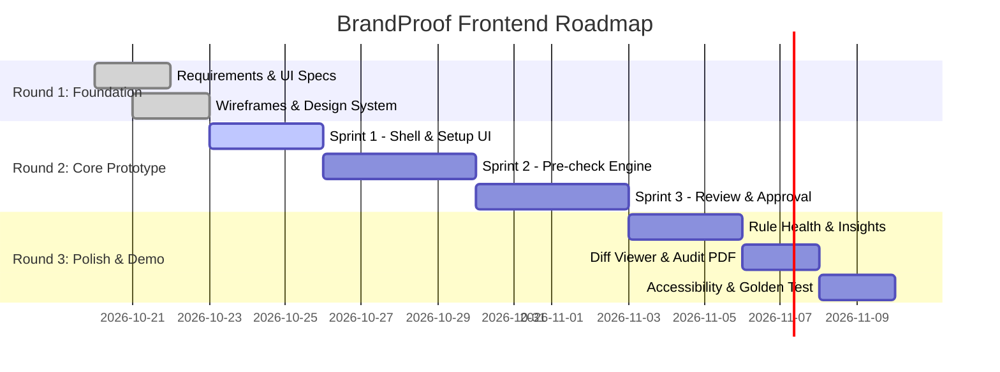

# BrandProof — Frontend Development Plan

> Milestone-driven implementation plan for the React + Vite + Tailwind CSS frontend application.
> Aligned with the Inkloom AI Hackathon rounds and team roles.

---

## 1. Ownership & Roles

| Team Member | Role | Frontend Focus Areas |
|---|---|---|
| **Jyoti Patra** | Frontend & Experience Lead | Core React UI architecture, screen development, design system, component library, accessibility (WCAG AA), user interaction flows. |
| **Anupam Pujari** | Backend & Data Lead | API contract alignment, Supabase Auth session bridge, CORS and upload endpoint testing. |
| **Jnanaranjan Majhi** | Team Leader & AI Engine Lead | Review engine data verification, finding card proof structure validation, golden test set UI reviews. |

---

## 2. Phased Development Roadmap

---

## 3. Sprint Breakdown

### Sprint 1: Application Shell & Source of Truth Setup (Round 2 — Days 1 to 3)

**Goal:** Establish runnable React app, authentication, role-based navigation, and setup screens for rules, facts, terminology, and assets.

- [ ] **Task 1.1: Project Scaffolding & Design System Setup**
  - Initialize Vite + React + TypeScript + Tailwind CSS project.
  - Configure Tailwind theme tokens (colors, font families, radius, focus rings).
  - Install core packages: `@supabase/supabase-js`, `@tanstack/react-query`, `react-router-dom`, `lucide-react`, `clsx`, `tailwind-merge`.
- [ ] **Task 1.2: Authentication & Protected Shell**
  - Build `AuthContext` wrapping Supabase Auth login/logout.
  - Build `AppShell` with collapsible sidebar, topbar breadcrumbs, notification trigger, and user profile badge.
  - Implement role-based navigation filtering (Creator, Reviewer, Manager, Admin).
- [ ] **Task 1.3: Source of Truth Setup Modules**
  - **Rulebook Manager**: Table of active rules, category filters, and active/inactive toggles.
  - **Facts Vault**: Searchable table showing claims, owners, expiry dates, and CSV import modal.
  - **Terminology Manager**: Tabbed view of preferred and banned vocabulary.
  - **Asset Library**: Palette swatch viewer and logo gallery with usage guidelines.

**Deliverable / Exit Check 1:** Manager can log in, navigate between all setup screens, create/view facts and rules, and see role-restricted navigation when switching accounts.

---

### Sprint 2: Content Submission & Finding Card Engine (Round 2 — Days 4 to 7)

**Goal:** Allow creators to input drafts, trigger backend pre-checks, and interactively resolve findings with proof and intent preservation.

- [ ] **Task 2.1: Multi-Format Content Submission Workspace**
  - Content creation form supporting text paste, social post (caption + image), and file upload (PDF/DOCX/images).
  - Form integration for **Intent Lock**: Purpose, Target Audience, and Key Message.
  - File upload progress and validation (size limits, MIME types).
- [ ] **Task 2.2: Findings & Proof Rail Architecture**
  - Split-pane review layout (content preview on left, findings stack on right).
  - Synchronized highlight markers in text mapped to active finding cards.
  - Filter findings by severity (Critical, Warning, Info) and category (Claims, Tone, Terms).
- [ ] **Task 2.3: Finding Card Implementation (`<FindingCard />`)**
  - Visual badges for severity (`Critical`, `Warning`, `Info`) and check origin (`Rule check` vs. `AI-assisted`).
  - Render exact source citations: rule quotes with page numbers or Claim Passport proof.
  - "Needs human judgement" banner for low-confidence AI findings (< 0.75).
  - Interactive actions: `Accept Fix`, `Edit Fix`, and `Dismiss`.
- [ ] **Task 2.4: Dismissal Reason Modal & AI Disclosure Panel**
  - Mandatory justification modal for dismissing critical/warning findings (FC1.2).
  - Collapsible AI disclosure panel detailing masked tokens, model invoked, and timestamp.

**Deliverable / Exit Check 2:** A creator can submit a draft, view findings with citations, accept a suggested fix directly into the editor, dismiss a warning with a reason, and view the AI disclosure.

---

### Sprint 3: Review Collaboration, Approvals & Diffing (Round 2 — Days 8 to 11)

**Goal:** Enable reviewers and brand managers to review submissions, inspect diffs, comment, approve, or request revisions.

- [ ] **Task 3.1: Review Queue Dashboard**
  - Data table showing all drafts in `in_review` status.
  - Severity count pills, submitter details, and priority sorting.
- [ ] **Task 3.2: Reviewer Decision Workspace**
  - Split-pane view highlighting unresolved findings and creator dismissal reasons.
  - Self-approval block: enforce constitution rule FC1.3 (hide "Approve" button if current user created the draft).
  - Decision buttons: `Approve for Publication` vs. `Request Changes` (with required feedback).
  - Threaded comment system on specific findings or paragraphs.
- [ ] **Task 3.3: Version Diff Visualizer (`<VersionDiffView />`)**
  - Integrated `diff-match-patch` viewer showing side-by-side or unified additions (green) and deletions (red).
  - Version selector dropdown comparing any two drafts.
- [ ] **Task 3.4: Rulebook Compiler Interface**
  - PDF/DOCX guideline upload dropzone.
  - Table of proposed rules with source quotes and confidence scores.
  - In-place batch approval and example editing.

**Deliverable / Exit Check 3:** A draft moves through the complete lifecycle: Creator Draft -> Pre-check -> Fix -> Submit -> Reviewer Inspection -> Version Diff -> Final Manager Approval.

---

### Sprint 4: Insights, Accessibility & Demo Polish (Round 3 — Days 12 to 16)

**Goal:** Deliver enterprise-grade rule health insights, complete WCAG AA accessibility, golden set verification, and demo polish.

- [ ] **Task 4.1: Rule Health & Recurring Mistakes Dashboards**
  - Dispute and override analytics per rule.
  - Visual indicators for "Unclear Rules" based on high creator dismissal rates.
  - AI rule rewrite proposal modal with one-click adoption into active rulebook.
  - Recurring mistake charts segmented by team and category.
- [ ] **Task 4.2: Exportable Audit Record (PDF Preview)**
  - View full immutable audit trail: all versions, findings caught, creator dismissals, reviewer sign-offs, and AI disclosures.
  - Trigger backend PDF generation or client print stylesheet.
- [ ] **Task 4.3: Accessibility & Design Audit (WCAG 2.1 AA)**
  - Automated `axe-core` scan across all screens.
  - Keyboard focus trapping on all dialogs and full `J`/`K`/`A`/`D` shortcut navigation in review workspace.
  - Verify 4.5:1 text contrast ratios.
- [ ] **Task 4.4: Golden Test Set Demo Preparation**
  - Load sample brand dataset (fictional brand "ApexCloud").
  - Test and verify UI against 40-50 golden sample drafts.
  - Rehearse end-to-end 5-minute live hackathon demo flow.

---

## 4. Prioritization Matrix (Scope Control)

| Priority | Features Included | Fallback if Time Constrained |
|---|---|---|
| **Must Have** | • Full Auth & Role-based Shell • Content Submission (Text + Image) • Finding Cards with Proof & Citations • Dismissal Reason Modal • Intent Lock & Meaning Check • Review Queue & Approval Flow • Facts Vault & Active Rulebook • AI Disclosure Panel | Non-negotiable. Core hackathon demo depends on this chain. |
| **Should Have** | • Rulebook Compiler PDF staging UI • Version Diff Visualizer (`diff-match-patch`) • Rule Health & Disputed Rules list • PDF Approval Record export trigger | Use manual rule entry if compiler UI is behind; use simple text comparison if diff viewer lags. |
| **Could Have** | • Recurring Mistakes heatmaps • Dark mode theme toggle • Keyboard shortcut overlay modal • PPTX slide deck upload preview | Cut first without affecting judging criteria. |

---

## 5. Risk Management & Frontend Mitigation

| Risk | Likelihood | Impact | Frontend Mitigation |
|---|---|---|---|
| **Backend API endpoints delayed** | Medium | High | Maintain TypeScript mock data handlers (MSW or static JSON mocks) matching `api-contract.md` so UI build never halts. |
| **Slow AI response times during demo** | High | High | Display animated step-by-step progress indicator ("Extracting claims...", "Consulting Facts Vault...", "Evaluating tone..."); support instant demo replay using cached results. |
| **Messy PDF text extraction in UI** | Medium | Medium | Provide clean monospace fallback viewer with raw extracted text view rather than full PDF canvas if layout extraction glitches. |
| **Screen layout breaks on smaller screens** | Low | Low | Scope primary demo resolution to standard 1080p desktop; enforce minimum container widths with horizontal scroll fallback. |
