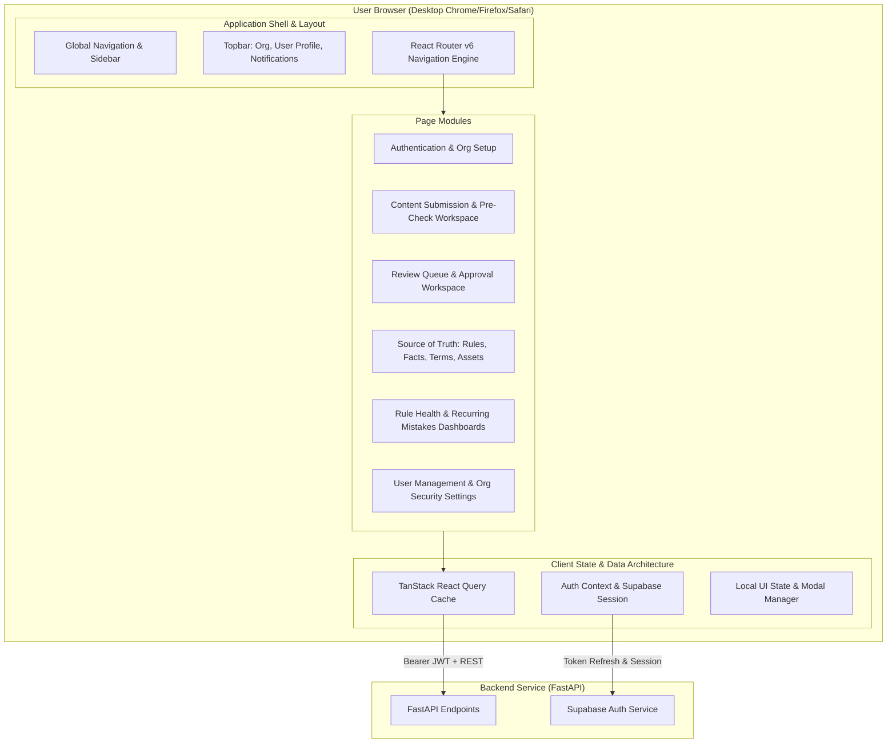
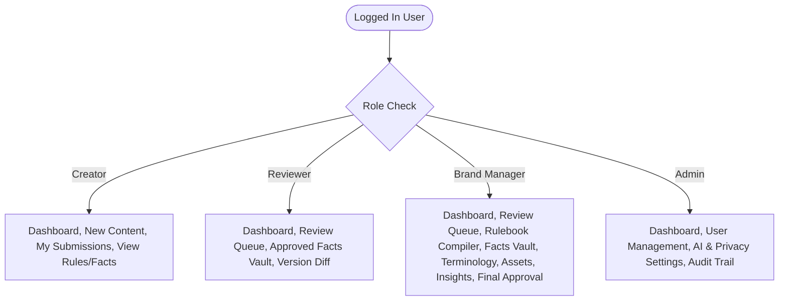

# BrandProof — Frontend Technical Specification

> Detailed architectural and technical design for the React + Vite + Tailwind CSS web application.
> Defines application structure, component hierarchy, page behaviors, state management, and interaction flows.

---

## 1. Architecture Overview

BrandProof's frontend is a single-page application (SPA) built using React 18, Vite, and Tailwind CSS. It communicates with the FastAPI backend over HTTPS using RESTful JSON endpoints and authenticates requests via Supabase JWTs.



### 1.1 Technical Stack & Dependencies

| Layer | Library / Tool | Version | Purpose |
|---|---|---|---|
| **Runtime & Build** | Vite + React | React 18.x, Vite 5.x | Ultra-fast HMR, lightweight bundling, modern ES modules |
| **Routing** | React Router DOM | v6.x | Client-side routing, nested layouts, protected route guards |
| **Styling** | Tailwind CSS + Lucide Icons | v3.4+, Lucide React | Utility-first design tokens, consistent icons, responsive layouts |
| **Server State** | TanStack React Query | v5.x | Data caching, background refetching, mutation lifecycle, query keys |
| **Authentication** | `@supabase/supabase-js` | v2.x | Session token persistence, auto-refresh, login/logout operations |
| **Diffing Engine** | `diff-match-patch` | v1.0.5 | Highlighting textual additions and deletions across version histories |
| **Form Handling** | `react-hook-form` + `zod` | Latest | High-performance uncontrolled forms with schema validation |
| **Accessibility & Overlays** | Headless UI / Radix primitives | Latest | Accessible dialogs, dropdowns, popovers with keyboard focus traps |

---

## 2. Application Shell & Layout System

### 2.1 Layout Breakdown

The application uses a persistent two-pane shell for all authenticated views:
1. **Left Sidebar (Navigation)**: Collapsible sidebar (240px wide expanded, 72px collapsed) displaying role-scoped navigation links, brand logo, and active workspace tag.
2. **Top Header**: Breadcrumbs, Notification bell with unread badge, "Rules-Only" mode indicator pill, Org Switcher (if multi-org), and User Profile avatar dropdown.
3. **Main Content Canvas**: Scrollable content viewport with responsive container max-widths (`max-w-7xl` or full-bleed `w-full` for side-by-side review workspaces).

### 2.2 Role-Based Navigation Matrix

The sidebar dynamically renders only the modules permitted for the logged-in user's role:



---

## 3. Route Hierarchy & Route Guards

```
/                             -> Root redirect based on role and auth state
/login                        -> Supabase email/password login
/signup                       -> User signup and organization onboarding
/unauthorized                 -> 403 Forbidden screen with switch role prompt

/ (Authenticated Shell - ProtectedRoute)
├── /dashboard                -> Role-customized dashboard overview
│
├── /content
│   ├── /content/new          -> Multi-step content submission & Intent Lock
│   ├── /content/:id          -> Content workspace (interactive preview + findings)
│   ├── /content/:id/diff     -> Version comparison view (diff-match-patch)
│   └── /content/mine         -> Creator's submissions list & tracking
│
├── /review
│   ├── /review/queue         -> Assigned reviews table (in_review status)
│   └── /review/:id           -> Reviewer decision interface (comments, accept/reject)
│
├── /source-of-truth
│   ├── /rules                -> Rulebook manager (view, filter, toggle active)
│   ├── /rules/compile        -> Rulebook Compiler (PDF upload -> proposed rules)
│   ├── /facts                -> Facts Vault (CRUD facts, verify expiry dates, CSV import)
│   ├── /terms                -> Terminology manager (preferred/banned vocabulary)
│   └── /assets               -> Brand Asset library (palette, logos, typography)
│
├── /insights
│   ├── /insights/rule-health -> Dispute rates, override statistics, AI rewrite proposals
│   └── /insights/recurring   -> Recurring mistake clusters by rule, category, and department
│
└── /settings
    ├── /settings/users       -> Admin: user invitations, roles, activation toggle
    └── /settings/privacy     -> Admin: AI provider select, PII masking toggles, rules-only flag
```

---

## 4. Screen & Component Specifications

### 4.1 Content Submission & Pre-Check Workspace (`/content/new` & `/content/:id`)

The core engine where creators draft, verify, and resolve issues before requesting formal review.

#### Layout Architecture (Split View Workspace)
- **Left Pane (60% width)**: Content Editor / Document Viewer.
  - Text input (direct paste) or formatted document renderer (PDF/DOCX/social card).
  - Synchronized highlight marks over flagged text segments mapped to finding IDs.
  - Hovering a highlight focuses and scrolls to the corresponding finding card on the right.
- **Right Pane (40% width)**: Findings & Proof Rail.
  - Sticky header showing: Pre-check status badge (`Running`, `Issues Found`, `Clean`), Total findings count broken down by severity (Critical, Warning, Info).
  - Filter tabs: `All`, `Claims`, `Tone`, `Terminology`, `Visual/Accessibility`.
  - Stack of `FindingCard` components.
  - Collapsible `IntentLockDrawer` and `AIDisclosurePanel`.

#### The Finding Card Component (`<FindingCard />`)
The atomic unit of BrandProof explainability. Must render:
1. **Severity Badge**:
   - `CRITICAL` (Red `#DC2626` background, Octagon alert icon)
   - `WARNING` (Amber `#D97706` background, Triangle alert icon)
   - `INFO` (Blue `#2563EB` background, Info circle icon)
2. **Check Origin Pill**:
   - `Rule Check` (Purple outline, static code icon)
   - `AI-Assisted` (Cyan outline, spark icon)
3. **Flagged Text & Context**: Quoted verbatim snippet from user's draft in monospace font.
4. **Issue Statement**: Concise explanation of the violation.
5. **Proof & Source Citation**:
   - Rule-based: `Rule R-14 (Terminology)` with direct quote from guideline PDF and page number.
   - Claim-based: `Claim Passport` showing match status (`Supported`, `Outdated [Expired 2026-06-30]`, `Conflicting`, `Unsupported`).
6. **Confidence & Judgement Indicator**:
   - If confidence < 0.75: Amber italic banner `"Needs human judgement — confidence 68%"`.
7. **Action Suite**:
   - **Accept Fix**: Replaces highlighted text with `suggested_fix` in the draft editor.
   - **Edit Fix**: Opens inline editor with pre-filled suggestion.
   - **Dismiss**:
     - For `INFO`: Dismisses directly.
     - For `CRITICAL` or `WARNING`: Opens **Dismissal Reason Modal** requiring creator to input a justification. Logs dismissal to Rule Health.

#### The Intent Lock Panel (`<IntentLockPanel />`)
- Captures creator's intent during drafting:
  - `Target Audience` (e.g., Enterprise CTOs, retail customers).
  - `Core Purpose` (e.g., Inform about feature launch, drive demo signup).
  - `Key Message` (Primary takeaway that must not be altered).
- **Meaning Check Visualizer**: When a suggested fix is evaluated, presents a 2-column comparison showing key takeaways before vs. after to assure the creator that tone fixes did not erode their fundamental pitch.

#### The AI Disclosure Panel (`<AIDisclosurePanel />`)
- Placed in the footer or expandable drawer of every content review.
- Discloses:
  - AI Service invoked (e.g., `Anthropic Claude 3.5 Sonnet` or `Local Ollama Mistral`).
  - Request Timestamp.
  - PII Masking Report: List of scrubbed tokens (e.g., `3 phone numbers masked`, `1 confidential term replaced with [CONFIDENTIAL-1]`).
  - Exact payload excerpt dispatched to external model.
  - Zero-AI badge if workspace is operating in "Rules-Only Mode".

---

### 4.2 Review Queue & Reviewer Workspace (`/review/queue` & `/review/:id`)

Built specifically for Legal, Compliance, and Brand Reviewers.

#### Review Queue (`/review/queue`)
- Filterable data table displaying:
  - Document Title & Content Type (Social, Email, Document, Image).
  - Creator Name & Team/Department.
  - Submission Timestamp.
  - Outstanding Findings Breakdown: Critical (Red count), Warnings (Yellow count), Dismissed by Creator (Purple badge with explanation count).
  - Claim Flags: `Unsupported Claims Present` warning tag.
  - Action button: `Review Draft`.

#### Reviewer Workspace (`/review/:id`)
- **Diff First Mode**: If version > 1, the reviewer default view highlights changes made by creator between the initial submission and current revision using `diff-match-patch`.
- **Claim Inspector**: Reviewer can click any claim finding to see the source fact card, owner contact, and verified documentation.
- **Review Decision Drawer**:
  - `Approve`: Disabled if the reviewer is the content creator (enforces non-negotiable constitution principle FC1.3).
  - `Request Changes`: Requires feedback note; changes content state back to `changes_requested` and routes task back to Creator.
  - `Inline Comments`: Allows adding comments pinned to specific text paragraphs or findings.

---

### 4.3 Source of Truth Setup Screens

Designed for Brand Managers to configure the brand boundary conditions without needing engineering intervention.

#### 1. Rulebook Manager & Compiler (`/source-of-truth/rules`)
- **Compiler Tab**:
  - Drag-and-drop zone for Brand Guideline PDF / DOCX files.
  - Upload progress bar + extraction status indicator.
  - Staging table showing AI-proposed extracted rules:
    - Rule Title & Category (`Tone`, `Terminology`, `Claims`, `Visual`, `Accessibility`).
    - Source Citation: Extracted verbatim quote + PDF Page Number.
    - Generated Good & Bad Examples.
    - Status: `Needs Human Review`.
  - Batch Actions: `Approve Selected`, `Reject`, `Edit In-Place`.
- **Active Rulebook Tab**:
  - Searchable list of approved rules with active/inactive toggles.
  - "Needs Examples" warning badge for ambiguous rules.

#### 2. Approved Facts Vault (`/source-of-truth/facts`)
- Grid / Table view of verified brand assertions.
- Fields: Fact Title, Exact Value / Claim Statement, Fact Owner (User reference), Source Documentation Link, Expiry Date.
- Visual Status Pills:
  - `Active` (Green)
  - `Expiring Soon (< 30 days)` (Amber)
  - `Expired` (Red)
- CSV Import modal with drag-and-drop file upload and schema preview.

#### 3. Terminology Manager (`/source-of-truth/terms`)
- Tabbed management for:
  - **Preferred Terms**: Recommended word, reason, target context.
  - **Banned Terms**: Forbidden word, suggested alternative, strictness level.
- Case-sensitivity and whole-word matching switches.

#### 4. Brand Asset Library (`/source-of-truth/assets`)
- **Palette Viewer**: Hex swatch grid showing primary, secondary, and accent colors with automatic WCAG AA contrast ratio calculations against white and dark backgrounds.
- **Logos Gallery**: Approved SVG/PNG files with minimum clearance notes, minimum pixel dimensions, and prohibited misuse visual rules.

---

### 4.4 Rule Health & Insights Dashboards (`/insights/*`)

Transforms routine governance rejections into systemic organizational intelligence.

#### Rule Health Dashboard (`/insights/rule-health`)
- **Disputed Rules Table**:
  - Lists rules ordered by dispute rate (`dismissal_count / trigger_count`).
  - Highlights rules triggering excessive creator pushback.
  - Flags rules marked as "Unclear Rule" by creators.
- **AI Rule Rewrite Proposal Card**:
  - Displays currently ambiguous rule text.
  - Displays AI-generated clarifying rewrite based on common dismissal justifications.
  - `Adopt Rewrite` button for Brand Manager to instantly update the active rulebook.

#### Recurring Mistakes Matrix (`/insights/recurring`)
- Bar chart / Heatmap of violations categorized by:
  - Department / Team (e.g., Marketing vs. Sales vs. Regional Agencies).
  - Rule Category (Tone violations vs. Outdated claims vs. Contrast failures).
  - Time trends (Weekly violation frequency).

---

## 5. Client State & Cache Management (TanStack Query)

### 5.1 Query Key Architecture

To prevent stale data, enforce optimistic updates where safe, and maintain cache coherence:

```typescript
export const queryKeys = {
  auth: {
    session: ['auth', 'session'] as const,
    profile: ['auth', 'profile'] as const,
  },
  content: {
    all: ['content'] as const,
    list: (filters: ContentFilters) => ['content', 'list', filters] as const,
    detail: (id: string) => ['content', 'detail', id] as const,
    findings: (id: string) => ['content', 'findings', id] as const,
    versions: (id: string) => ['content', 'versions', id] as const,
    diff: (id: string, v1: number, v2: number) => ['content', 'diff', id, v1, v2] as const,
  },
  review: {
    queue: (filters: ReviewFilters) => ['review', 'queue', filters] as const,
    comments: (contentId: string) => ['review', 'comments', contentId] as const,
  },
  sourceOfTruth: {
    rules: (filters: RuleFilters) => ['rules', filters] as const,
    ruleDetail: (id: string) => ['rules', 'detail', id] as const,
    facts: (filters: FactFilters) => ['facts', filters] as const,
    terms: (type: 'preferred' | 'banned') => ['terms', type] as const,
    assets: ['assets'] as const,
  },
  insights: {
    ruleHealth: ['insights', 'rule-health'] as const,
    recurringMistakes: (timeRange: string) => ['insights', 'recurring', timeRange] as const,
  },
  notifications: {
    unread: ['notifications', 'unread'] as const,
    all: ['notifications', 'all'] as const,
  }
};
```

### 5.2 Invalidation & Mutation Triggers

- **Submitting Content**: Invalidates `['content', 'list']`, `['review', 'queue']`.
- **Resolving / Dismissing Finding**: Invalidates `['content', 'findings', id]`, `['content', 'detail', id]`.
- **Approving / Requesting Changes**: Invalidates `['review', 'queue']`, `['content', 'detail', id]`, `['notifications']`.
- **Approving Rule from Compiler**: Invalidates `['rules']`.
- **Updating Fact Expiry**: Invalidates `['facts']`, triggers pre-check revalidation.

---

## 6. Accessibility & Keyboard Navigation (WCAG 2.1 AA)

1. **Color Independence**: Severity is never conveyed through color alone. Every card and pill pairs color with an explicit semantic icon (`OctagonAlert`, `TriangleAlert`, `Info`) and text label.
2. **Focus Management**:
   - Opening the Dismissal Reason modal traps focus within the dialog.
   - Closing the modal restores focus to the triggering "Dismiss" button.
3. **Keyboard Shortcuts**:
   - `J` / `K`: Move focus to next / previous finding card.
   - `A`: Accept fix on focused card.
   - `D`: Open dismiss prompt on focused card.
   - `Escape`: Close active modal or drawer.
4. **Contrast Requirements**: All text tokens in Tailwind configuration maintain a contrast ratio >= 4.5:1 against their corresponding surfaces.

---

## 7. Error Handling & Edge Cases

| Scenario | UI Behavior |
|---|---|
| **401 Unauthorized** | Supabase session invalid or expired; redirects to `/login` with `?redirect=` return parameter. |
| **403 Forbidden** | User navigated to a page above their role; displays `Access Denied` card with link to `/dashboard`. |
| **Backend Offline / 503** | Sticky red alert banner: "Backend unreachable. Offline changes will not be saved." Disables mutation buttons. |
| **Network Timeout during AI check** | Pre-check status changes to "AI check timed out. Retrying with rules-only fallback..." |
| **Large File Upload (> 20MB)** | Client-side validation blocks upload before network transfer with toast: "File size exceeds 20MB limit." |
| **Stale Version Conflict (409)** | Warning modal: "A new version of this content was submitted by another reviewer. Reloading latest changes." |
